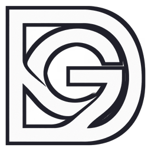
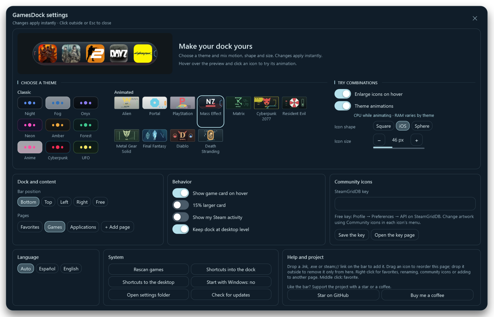
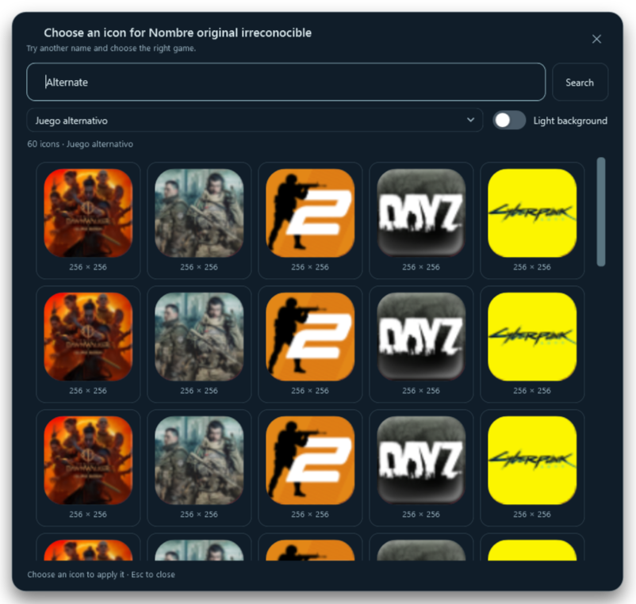

<p align="center"></p>

# GamesDock v2.00

A game and application dock for **Windows 10/11 x64**. Discover games, organize independent pages and choose **SteamGridDB community icons directly inside the dock**.

[Download v2.00](https://github.com/sadri-99/GAMESDOCK/releases/tag/v2.00) · [Español](README.md) · [Changelog](CHANGELOG.md) · [User guide, Spanish](docs/USO.md)

## Themes in motion

**20 themes: nine Classic and 11 Animated**, with individual contours, hover responses and launch sequences. Theme motion and magnification can be toggled separately. Compact original margins; emblems in the picker, without a logo beneath the focused icon.


[PNG: 1680 × 2080](docs/screenshots/v2.00/Sagas-1.png) · [PNG: 1680 × 1740](docs/screenshots/v2.00/Sagas-2.png) · [Theme details](docs/TEMAS-SAGAS.md)

PNGs are rendered from WPF at 192 DPI. GIFs use reduced temporal sampling for sharing; they are not application FPS measurements. Franchise names and symbols describe visual inspiration. GamesDock is not affiliated with their owners.

### Settings with Horizon



Themes, animation, magnification and the interactive preview sit together. Other settings remain visible; only theme thumbnails scroll. Clicking outside, Esc or the close button saves and closes settings.

## New in v2.00

- **Independent pages:** Favorites, Games and Applications, plus up to five custom pages. Each keeps its own members, order and folders. Adding an app to a page does not add it to Favorites.
- **Multiple monitors:** drag the dock to another display; it remembers that monitor and position on startup. Visible recovery if the preferred display disconnects.
- **SteamGridDB search:** try an alternative name, choose the matching game or edition and replace an icon inside the dock. Larger cards and a fixed search/close header.
- **Game cards:** rounded banner corners, more text spacing and optional 115% size. Optional personal Steam playtime and last-played information from the active local account, disabled by default.
- **Simpler menus:** highlighted lock without a checkmark gutter; consistent text padding.
- **Animated themes reviewed:** cleaner PlayStation selection, slower Cyberpunk, Diablo without the tracking ring or static central runes, and sliding droplets for Death Stranding.
- **Less repeated work:** reusable preview controls, cached Matrix columns and clocks that stop when finished, preserving effects and movement.

[Full changes since v1.9.5](CHANGELOG.md) · [v2.00 release notes](docs/releases/v2.00.md)

### Community icons inside the dock

Add your free personal SteamGridDB key in Settings. Use the community icon search when the detected name does not match the website.



Only the gallery scrolls; search and close stay accessible. [SteamGridDB guide](docs/ICONOS-COMUNIDAD.md).

## Download and use

1. Download **GamesDock-Setup-2.00.exe** from the [v2.00 release](https://github.com/sadri-99/GAMESDOCK/releases/tag/v2.00).
2. Follow the Spanish/English wizard. Requires .NET Framework 4.8; no administrator privileges needed.
3. Open GamesDock from Start. Right-click the dock → **Settings**.

**GamesDock.exe** and a portable ZIP are also available. Setup uses `%LOCALAPPDATA%\Programs\GamesDock` and preserves `%APPDATA%\GamesDock` data and startup preferences. Exit the previous copy from the tray before upgrading. Pages migrate on first launch. Removed themes fall back to Night.

If you move the portable executable, open it from its new location to repair startup. The executable is not digitally signed. [Installation and startup](docs/INICIO-WINDOWS.md).

## Included

- Steam, Epic Games, GOG, Start menu and desktop shortcut detection.
- Drag `.exe`, `.lnk`, `.url` files or `steam://` links into the dock.
- Pages, manual Favorites and drag-to-create folders.
- Local icons, SteamGridDB artwork and Steam store information cards.
- Top, bottom, left, right or free placement; lock and multiple monitors.
- Show/hide with `Ctrl` + `Alt` + `D` or the tray menu.
- Move desktop shortcuts into the dock and restore their original locations.
- Spanish/English UI, optional Windows startup and confirmed GitHub updates.
- iOS icon shape for new profiles; 100% window opacity.

## Performance and privacy

Animations use CPU and memory while moving. Settings includes a resource label and explanation. Local reference: about **2.6–5.3% total CPU** with eight 64 px shortcuts and 12 logical processors, in an off-screen window. Short runs do not measure GPU, battery or game FPS. [Method and limits](docs/development/SAGAS-RENDIMIENTO.md).

Configuration and caches live in `%APPDATA%\GamesDock`. No personal settings, keys or logs are shipped. The SteamGridDB key is stored locally; never share `config.json`. Personal Steam activity is optional and read locally. The app queries GitHub for updates, Steam for cards and SteamGridDB for artwork. No first-party telemetry.

## Build and validate

Windows x64, .NET Framework 4.8 and Visual Studio Build Tools 2022 or later with Roslyn. No NuGet or .NET SDK required.

```powershell
./app/build.ps1
./app/tests/validate.ps1 -Executable "$PWD/app/GamesDock.exe" `
  -Baseline 'C:/path/to/previous/GamesDock.exe' `
  -OutputDirectory "$PWD/artifacts/validation"
./tests/test-startup.ps1
```

Use `-OutputPath "$PWD/artifacts/GamesDock.exe"` to preserve the published executable. Setup requires Inno Setup 6.7 or later: `./installer/build.ps1`.

[Validation](docs/development/VALIDACION-v2.00.md) · [Architecture](docs/development/ARQUITECTURA.md) · [Contributing](CONTRIBUTING.md)

## Documentation

[Guide](docs/USO.md) · [Themes](docs/TEMAS-SAGAS.md) · [Settings](docs/AJUSTES.md) · [SteamGridDB](docs/ICONOS-COMUNIDAD.md) · [Cards and personal Steam activity](docs/FICHAS.md) · [Monitors](docs/MULTIPANTALLA.md) · [Changelog](CHANGELOG.md)

## Donations

If GamesDock is useful to you, you can [buy me a coffee on PayPal](https://www.paypal.com/paypalme/sadriprods).

## License

[MIT](LICENSE). Artwork shown in screenshots belongs to its owners and illustrates customization.
