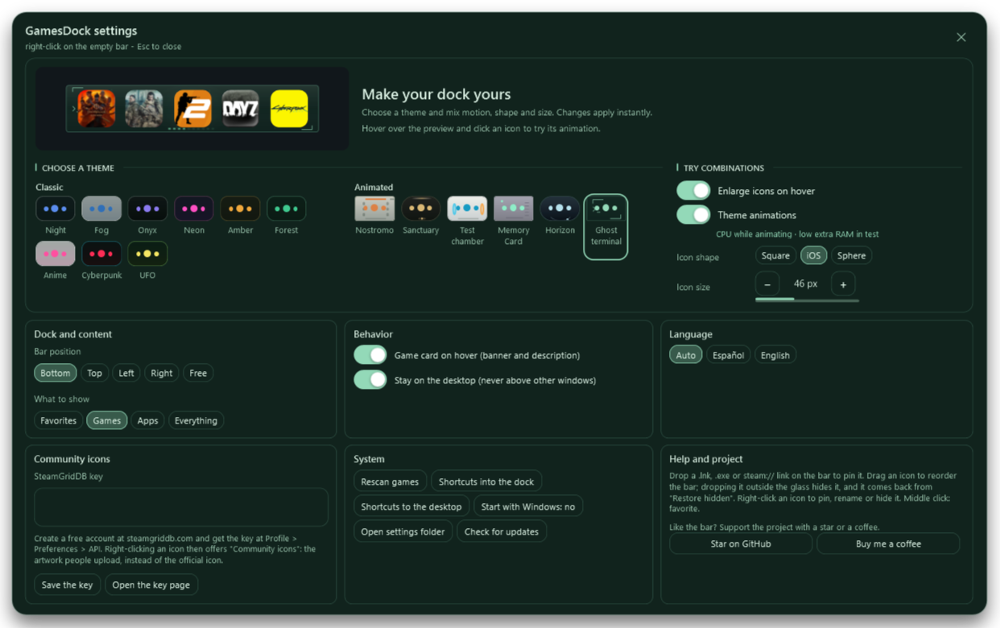
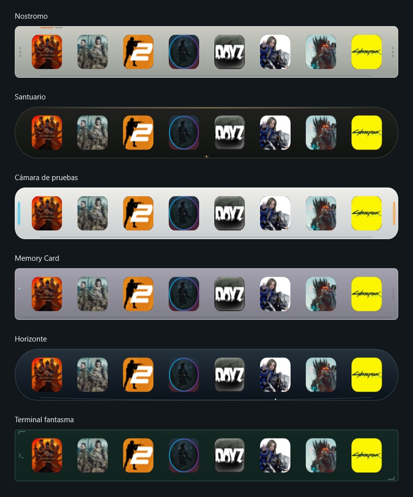

# GamesDock v1.9.5

A desktop dock for games and applications on **Windows 10/11 x64**. Simple setup wizard and portable executable. Requires .NET Framework 4.8.

[Download v1.9.5](https://github.com/sadri-99/GAMESDOCK/releases/tag/v1.9.5) · [Español](README.md) · [Full changelog (Spanish)](CHANGELOG.md)



## New in v1.9.5

Fixed Windows startup: launch the GUI executable directly with a per-user logon task, without VBScript or an added delay. Battery and offline use are supported. A Spanish/English setup wizard installs into `%LOCALAPPDATA%\Programs\GamesDock`, keeping the executable in a stable location. Downloaded setup files can be moved or deleted safely. Updates only select the exact `GamesDock.exe` asset.

## New in v1.9.1

A **Buy me a coffee** button sits beside the GitHub star in Settings → Help and project, opening PayPal in your browser. Spanish and English included.

## New in v1.9

- Nine original themes under **Classic**, plus six **Animated** themes inspired by Alien, Dark Souls, Portal, PlayStation, Mass Effect and Matrix.
- Theme-specific presentation, hover, focus and launch effects. Magnification follows each material and dock contour, including rectangular themes.
- A live preview, aligned theme thumbnails and all settings visible without scrolling. Animation and magnification toggles sit beside the theme selector.
- Five persistent preview controls. A local configuration-refresh test measured **97.2% fewer temporary allocations**; this does not mean the same reduction in total RAM.
- Window opacity fixed at 100%; iOS shape for new installations. Existing shape choices are preserved.
- Fixed corner clipping when entering the dock with magnification disabled.

## Start

Download **GamesDock-Setup-1.9.5.exe** from the [v1.9.5 release](https://github.com/sadri-99/GAMESDOCK/releases/tag/v1.9.5) and follow the wizard. Choose optional Windows startup and desktop shortcut. No administrator rights required. Close any older copy before installing; settings, folders, and favorites remain in `%APPDATA%\GamesDock`.

The portable **GamesDock.exe** is also available. If moved, open it once at its new location to repair enabled startup. Windows cannot discover a moved executable before it runs again. The installer avoids that problem through a stable installation directory.

The executable is unsigned. Windows may show its normal warning for downloaded applications.

## Features

Detects Steam, Epic Games, GOG, Start menu and desktop shortcuts. Drag files or Steam links onto the dock; search, filter, reorder, favorite or group entries into folders. Use your own artwork or SteamGridDB community icons with a personal API key. Hover cards show artwork and Steam details.

Position the dock on any screen edge or freely. Lock position and icons, move shortcuts from the desktop and restore them later. Toggle visibility with `Ctrl` + `Alt` + `D` or the tray. Spanish and English interfaces, optional Windows startup and update checks with installation confirmation are included.



## Performance and privacy

Animation costs resources while active. Settings includes a CPU/memory notice and measurement limits. Effects and the 60 Hz target are preserved. More frequent preview updates can increase CPU in some themes; no universal CPU or game-FPS improvement is claimed. GPU, battery and game FPS were not measured.

Data and caches stay in `%APPDATA%\GamesDock`. GitHub handles update checks; Steam and SteamGridDB provide game details and artwork using a game identifier or name. Your SteamGridDB key stays in local `config.json`; do not share that file. No custom telemetry is included.

## Build and validate

Use Windows x64, .NET Framework 4.8 and Visual Studio Build Tools 2022 or later with Roslyn. No .NET SDK required.

```powershell
./app/build.ps1
```

Creates `app/GamesDock.exe`. Supply an older executable as a reference for validation:

```powershell
./app/tests/validate.ps1 -Executable "$PWD/app/GamesDock.exe" `
  -Baseline 'C:/path/previous/GamesDock.exe' `
  -OutputDirectory "$PWD/artifacts/validation"
```

The v1.9 suite passed **14,121 checks** covering themes, geometry, animation, magnification, both translations and preview lifecycle. Another 180 main-dock fixtures retained identical pixels across renderer optimizations.

Detailed [architecture](docs/development/ARQUITECTURA.md), [theme guide](docs/TEMAS.md), [dock performance](docs/development/RENDIMIENTO.md) and [preview measurements](docs/development/RENDIMIENTO-MUESTRA.md) are available in Spanish.

## Donations

If GamesDock is useful to you and you want to support development, [buy me a coffee on PayPal](https://www.paypal.com/paypalme/sadriprods). Thank you for your support.

## License

[MIT](LICENSE). Artwork shown in screenshots belongs to its respective owners. Franchise names identify visual inspiration; GamesDock is not affiliated with their owners.
