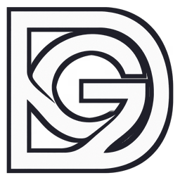
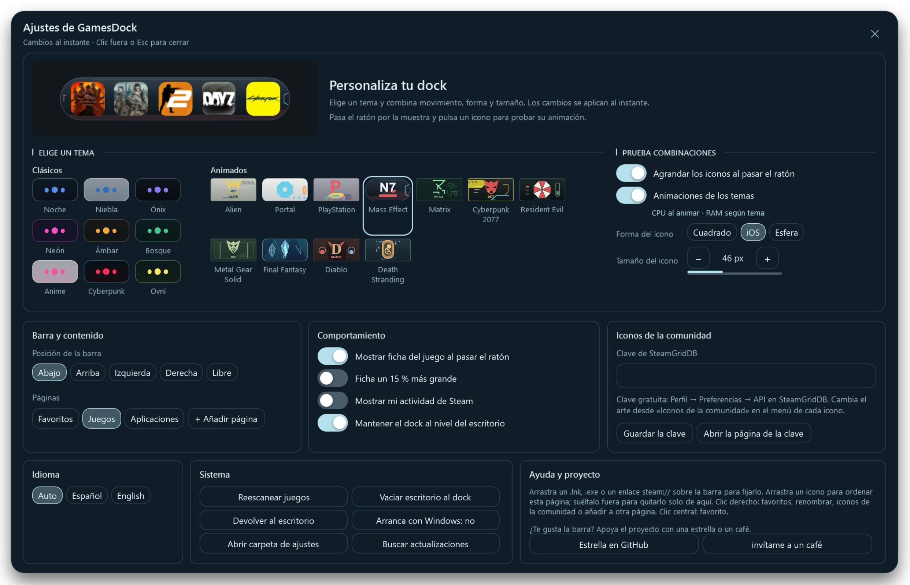
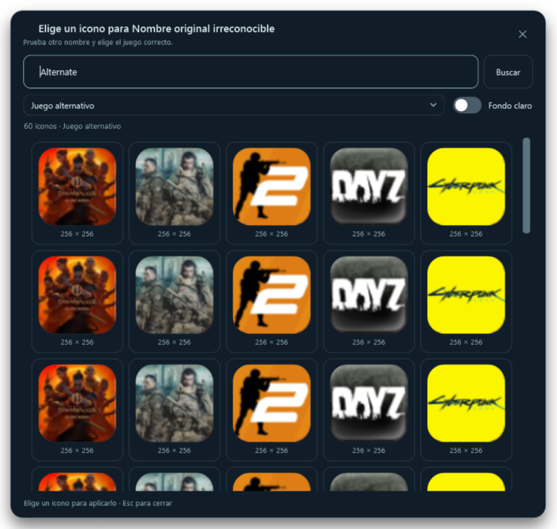

<p align="center"></p>

# GamesDock v2.00

Tu biblioteca de juegos y aplicaciones en un dock para **Windows 10/11 x64**. Detecta juegos, organiza páginas independientes y permite elegir iconos de **SteamGridDB desde el propio dock**.

[Descargar v2.00](https://github.com/sadri-99/GAMESDOCK/releases/tag/v2.00) · [English](README.en.md) · [Cambios](CHANGELOG.md) · [Guía](docs/USO.md)

## Temas en movimiento

**20 temas: nueve clásicos y 11 animados**, con contornos, gestos de aumento y secuencias propias. Animación y agrandado se activan por separado. Márgenes compactos; emblemas en el selector, sin logos al pie del icono seleccionado.


[PNG: 1680 × 2080](docs/screenshots/v2.00/Sagas-1.png) · [PNG: 1680 × 1740](docs/screenshots/v2.00/Sagas-2.png) · [Detalles de cada tema](docs/TEMAS-SAGAS.md)

PNG dibujados a 192 DPI desde WPF. GIF con muestreo temporal reducido para compartir; no miden los FPS de la aplicación. Los nombres y símbolos identifican la inspiración visual; GamesDock no está afiliado a sus titulares.

### Ajustes con Horizonte



Tema, animaciones, agrandado y muestra interactiva juntos. El resto de ajustes permanece visible; solo se desplazan las miniaturas de temas. Clic fuera, Esc o la cruz guardan y cierran.

## Novedades de v2.00

- **Páginas independientes:** Favoritos, Juegos y Aplicaciones, más cinco personalizadas. Cada una conserva accesos, orden y carpetas. Añadir a una página no añade favoritos.
- **Varias pantallas:** arrastra el dock a otra y recordará monitor y posición. Recuperación visible si se desconecta la pantalla preferida.
- **SteamGridDB mejorado:** busca otro nombre o edición, elige coincidencia y cambia el icono sin salir del dock. Tarjetas más claras; búsqueda y cierre siempre visibles.
- **Fichas con banner:** esquinas redondeadas, texto espaciado y tamaño opcional del 115 %. Horas y última partida de Steam opcionales, leídas de la cuenta local activa y desactivadas por defecto.
- **Menús simplificados:** bloqueo resaltado, sin tick ni hueco reservado, y márgenes interiores uniformes.
- **Animados revisados:** PlayStation sin símbolos redundantes, Cyberpunk pausado, Diablo sin anillo de seguimiento ni runas estáticas centrales y Death Stranding con gotas deslizantes.
- **Menos trabajo repetido:** muestra reutilizable, columnas Matrix cacheadas y relojes detenidos al terminar. Se conserva el dibujo y movimiento.

[Todos los cambios desde v1.9.5](CHANGELOG.md) · [Notas de v2.00](docs/releases/v2.00.md)

### Iconos de comunidad desde el dock

Introduce tu clave personal gratuita de SteamGridDB en Ajustes. Usa el buscador de la selección de iconos cuando el nombre detectado no coincida con la web.



Solo se desplaza la galería; la cruz y el buscador permanecen accesibles. [Guía de SteamGridDB](docs/ICONOS-COMUNIDAD.md).

## Descargar y usar

1. Descarga **GamesDock-Setup-2.00.exe** desde la [release v2.00](https://github.com/sadri-99/GAMESDOCK/releases/tag/v2.00).
2. Sigue el asistente en español o inglés. Requiere .NET Framework 4.8; instalación por usuario, sin administrador.
3. Abre GamesDock desde Inicio. Clic derecho en la barra → **Ajustes**.

También disponibles **GamesDock.exe** y un ZIP portable. El instalador usa `%LOCALAPPDATA%\Programs\GamesDock`, conserva `%APPDATA%\GamesDock` y la preferencia de inicio automático. Cierra la copia anterior desde la bandeja antes de actualizar. Las páginas se migran al abrir; los temas retirados pasan a Noche.

Si mueves la copia portable, ábrela desde la ubicación nueva para reparar el inicio automático. El ejecutable no está firmado digitalmente. [Instalación y arranque](docs/INICIO-WINDOWS.md).

## Qué incluye

- Detección de Steam, Epic Games, GOG, menú Inicio y accesos del escritorio.
- Arrastrar `.exe`, `.lnk`, `.url` o enlaces `steam://` para añadir accesos.
- Páginas, favoritos manuales y carpetas por arrastre.
- Iconos propios y de SteamGridDB; banners y datos de la tienda de Steam.
- Posición arriba, abajo, izquierda, derecha o libre; bloqueo y [varias pantallas](docs/MULTIPANTALLA.md).
- Ocultar/mostrar con `Ctrl` + `Alt` + `D` o desde la bandeja.
- Mover accesos del escritorio al dock y restaurarlos a su ubicación original.
- Español e inglés, inicio opcional con Windows y actualizaciones con confirmación.
- Forma iOS en perfiles nuevos y opacidad de ventana al 100 %.

## Rendimiento y privacidad

Las animaciones consumen CPU y memoria mientras se mueven. Ajustes muestra una etiqueta y su explicación. Referencia local: aproximadamente **2,6–5,3 % de CPU total**, con ocho accesos de 64 px y 12 procesadores lógicos, en una ventana fuera de pantalla. Son pasadas breves; no miden GPU, batería ni FPS de juegos. [Mediciones y límites](docs/development/SAGAS-RENDIMIENTO.md).

Configuración y cachés en `%APPDATA%\GamesDock`. No se incluyen datos personales, claves ni registros en repositorio o release. La clave de SteamGridDB se guarda localmente; no compartas `config.json`. Actividad personal de Steam local y opcional. La app consulta GitHub para actualizarse, Steam para fichas y SteamGridDB para arte. Sin telemetría propia.

## Compilar y comprobar

Windows x64, .NET Framework 4.8 y Visual Studio Build Tools 2022 o posterior con Roslyn. Sin NuGet ni SDK de .NET.

```powershell
./app/build.ps1
./app/tests/validate.ps1 -Executable "$PWD/app/GamesDock.exe" `
  -Baseline 'C:/ruta/anterior/GamesDock.exe' `
  -OutputDirectory "$PWD/artifacts/validation"
./tests/test-startup.ps1
```

Usa `-OutputPath "$PWD/artifacts/GamesDock.exe"` para conservar el binario publicado. Instalador: Inno Setup 6.7 o posterior y `./installer/build.ps1`.

[Validación](docs/development/VALIDACION-v2.00.md) · [Arquitectura](docs/development/ARQUITECTURA.md) · [Contribuir](CONTRIBUTING.md)

## Documentación

[Guía](docs/USO.md) · [Temas](docs/TEMAS-SAGAS.md) · [Ajustes](docs/AJUSTES.md) · [SteamGridDB](docs/ICONOS-COMUNIDAD.md) · [Fichas y Steam personal](docs/FICHAS.md) · [Monitores](docs/MULTIPANTALLA.md) · [Changelog](CHANGELOG.md)

## Donaciones

Si GamesDock te resulta útil, puedes [invitarme a un café en PayPal](https://www.paypal.com/paypalme/sadriprods).

## Licencia

[MIT](LICENSE). Las carátulas de las capturas pertenecen a sus titulares y muestran ejemplos de personalización.
