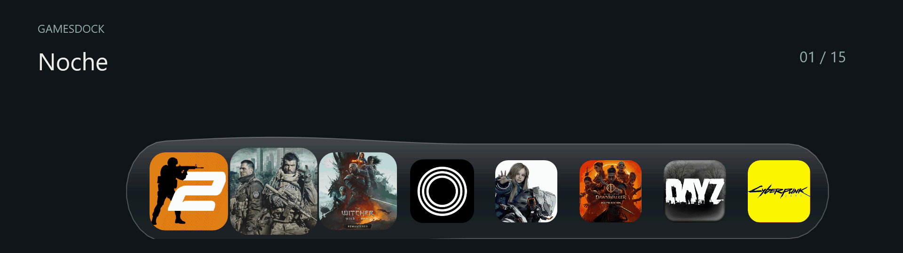
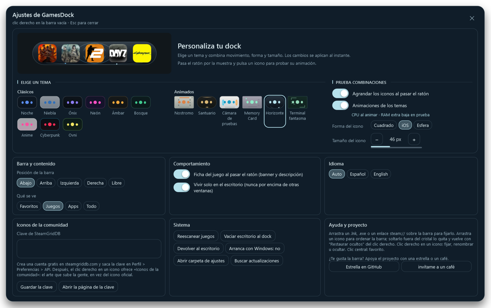

<p align="center">
  
</p>

# GamesDock v1.9.5

Dock de juegos y aplicaciones para **Windows 10/11 x64**. Instalador sencillo y ejecutable portable. Detecta juegos, organiza accesos y permanece al nivel del escritorio.

[Descargar v1.9.5](https://github.com/sadri-99/GAMESDOCK/releases/tag/v1.9.5) · [English](README.en.md) · [Cambios](CHANGELOG.md) · [Guía de uso](docs/USO.md)


## Novedades de v1.9.5

- **Inicio con Windows reparado**: ejecutable directo mediante tarea al entrar en sesión, sin VBScript ni retraso añadido. Funciona sin red y con batería.
- **Setup wizard en español e inglés**: instala en `%LOCALAPPDATA%\Programs\GamesDock`, crea acceso en Inicio y permite elegir inicio automático y acceso al escritorio. No necesita administrador.
- Mover o borrar el instalador descargado no afecta al arranque. La copia portable repara su registro al abrirla desde una ubicación nueva.
- Conserva ajustes, juegos y los 15 temas. Actualizador selecciona exclusivamente `GamesDock.exe`, nunca el instalador.

[Detalle y comprobaciones de v1.9.5](docs/releases/v1.9.5.md) · [Instalación e inicio con Windows](docs/INICIO-WINDOWS.md)

## Novedades de v1.9.1

Botón **«invítame a un café»** junto a la estrella de GitHub en Ajustes → Ayuda y proyecto. Abre PayPal en el navegador; también disponible en inglés.

## Novedades de v1.9

- **15 temas**, agrupados en **Clásicos** y **Animados**. Seis materiales nuevos inspirados en Alien, Dark Souls, Portal, PlayStation, Mass Effect y Matrix.
- Animaciones propias de cada tema: presentación, interacción, enfoque y lanzamiento. Acercamiento de iconos adaptado al material y al contorno de la barra.
- **Ajustes completos sin scroll**, con miniaturas alineadas, muestra interactiva y controles de animación y agrandado juntos.
- Muestra que reutiliza cinco controles: **97,2 % menos memoria temporal por actualización de configuración** en la prueba local. No equivale a reducir la RAM total en ese porcentaje.
- Opacidad de ventana al 100 % y forma iOS en instalaciones nuevas. Las formas elegidas anteriormente se conservan.
- Corregido el recorte de esquinas al entrar el cursor con el agrandado desactivado.

[Detalle de temas y movimiento](docs/TEMAS.md) · [Mediciones y límites](docs/development/RENDIMIENTO.md) · [Rendimiento de la muestra](docs/development/RENDIMIENTO-MUESTRA.md)

## Descargar y usar

1. Descarga **GamesDock-Setup-1.9.5.exe** desde la [release v1.9.5](https://github.com/sadri-99/GAMESDOCK/releases/tag/v1.9.5).
2. Sigue el asistente. Elige si quieres iniciar con Windows y crear acceso al escritorio. Requiere .NET Framework 4.8.
3. Abre GamesDock desde Inicio. Clic derecho en barra → **Ajustes**.

Para actualizar una copia portable anterior, ciérrala desde la bandeja e instala esta versión. Juegos, favoritos, carpetas y preferencias se conservan en `%APPDATA%\GamesDock`. El asistente mantiene la preferencia anterior de inicio automático. Después puedes borrar la copia portable antigua.

También se publica **GamesDock.exe** para uso portable. Si lo mueves, ábrelo una vez desde su ubicación nueva para reparar el inicio automático; si lo mueves sin abrirlo, Windows seguirá teniendo la ruta anterior. Recomendamos el instalador para evitar este problema.

El ejecutable no está firmado digitalmente. Windows puede mostrar su aviso habitual para aplicaciones descargadas.

## Qué incluye

- Detección de Steam, Epic Games, GOG, menú Inicio y accesos del escritorio.
- Arrastrar `.exe`, `.lnk`, `.url` o enlaces `steam://` para fijarlos.
- Búsqueda, favoritos, filtros de juegos/aplicaciones, orden y carpetas por arrastre.
- Iconos propios o de la comunidad mediante SteamGridDB; esta última función necesita una clave personal gratuita.
- Ficha del juego al pasar el ratón, con banner y datos de la tienda de Steam.
- Barra arriba, abajo, izquierda, derecha o en posición libre. Bloqueo de posición e iconos.
- Ocultar/mostrar con `Ctrl` + `Alt` + `D` o desde la bandeja.
- Accesos del escritorio al dock y restauración a su ubicación original.
- Interfaz en español e inglés e inicio opcional con Windows.
- Comprobación de actualizaciones en GitHub, con confirmación antes de instalar.

## Temas



[Ver los seis temas animados a 1680 × 2040](docs/screenshots/v1.9.5/temas-animados-hd.gif)

### Ajustes con el tema Horizonte



| Animado | Referencia | Detalles |
| --- | --- | --- |
| Nostromo | Alien | Radar, fósforo y cierre mecánico; contorno rectangular. |
| Santuario | Dark Souls | Brasas, calor y sello orbital. |
| Cámara de pruebas | Portal | Transferencia azul/naranja y respuesta de portal. |
| Memory Card | PlayStation | Paquetes de memoria, glifos y selección rectangular. |
| Horizonte | Mass Effect | Campo orbital, estela y lente gravitatoria. |
| Terminal fantasma | Matrix | Código, escaneo y corchetes de selección. |

Los nueve temas originales permanecen en Clásicos. Las animaciones y el agrandado se activan por separado. Las miniaturas del selector son estáticas. Los nombres de sagas identifican la inspiración visual; GamesDock no está afiliado a sus titulares.

## Rendimiento

Los efectos tienen coste mientras se mueven. Ajustes incluye un aviso de consumo y una explicación de la referencia local. Se conservan efectos, resolución y objetivo de 60 Hz; los relojes se detienen al finalizar su trabajo.

Las pruebas simplificadas no miden FPS de juegos, GPU ni batería. La optimización de la muestra reduce creación de controles y asignaciones; su respuesta más frecuente puede aumentar la CPU en algunos temas. Consulta las [mediciones reproducibles](docs/development/RENDIMIENTO-MUESTRA.md).

## Compilar y comprobar

Windows x64, .NET Framework 4.8 y Build Tools de Visual Studio 2022 o posterior, con Roslyn. No se requiere el SDK de .NET. Desde la raíz del repositorio:

```powershell
./app/build.ps1
```

Produce `app/GamesDock.exe`. Para compilar sin sustituir esa copia:

```powershell
./app/build.ps1 -OutputPath "$PWD/artifacts/GamesDock.exe"
```

La carpeta de destino se crea si hace falta. Las pruebas requieren un ejecutable anterior como referencia:

```powershell
./app/tests/validate.ps1 -Executable "$PWD/app/GamesDock.exe" `
  -Baseline 'C:/ruta/version-anterior/GamesDock.exe' `
  -OutputDirectory "$PWD/artifacts/validation"
```

**14.121 comprobaciones** en la validación de v1.9, incluidas traducciones, geometría, animaciones, regresión de agrandado y ajustes sin scroll. [Arquitectura y validación](docs/development/ARQUITECTURA.md).

## Datos y privacidad

Configuración y cachés viven en `%APPDATA%\GamesDock`; el arranque opcional crea un acceso en Inicio. No se incluye configuración personal en este repositorio ni en la release.

La aplicación consulta GitHub para actualizarse, Steam para las fichas y SteamGridDB para banners e iconos. Las búsquedas de contenido utilizan el identificador o nombre del juego. La clave personal de SteamGridDB se guarda localmente en `config.json`; no compartas ese archivo. No incluye telemetría propia. [Rutas y funcionamiento](docs/USO.md).

## Documentación

- [Cambios de v1.9](CHANGELOG.md)
- [Guía de uso](docs/USO.md)
- [Temas y personalización](docs/TEMAS.md)
- [Arquitectura y validación](docs/development/ARQUITECTURA.md)
- [Notas de la release](docs/releases/v1.9.md)
- [Contribuir](CONTRIBUTING.md)

## Donaciones

Si GamesDock te resulta útil y quieres apoyar su desarrollo, puedes [invitarme a un café en PayPal](https://www.paypal.com/paypalme/sadriprods). Gracias por el apoyo.

## Licencia

[MIT](LICENSE). Las carátulas visibles en las capturas pertenecen a sus respectivos titulares y se muestran como ejemplo de personalización.
