<p align="center">
  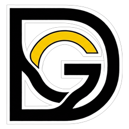
</p>

# GamesDock

Píldora translúcida al nivel del escritorio, para Windows, que sustituye a los accesos directos de
la mesa de trabajo: lanza videojuegos y cualquier aplicación, detecta sola los juegos que ya tienes
instalados y se aparta cuando no la usas.

El producto completo es **un único `.exe`** (`app/GamesDock.exe`, ≈ 503 KiB): sin instalador, sin
servicios y sin dependencias externas. Solo dos cosas sacan la barra a internet, y ninguna manda datos
de tu equipo ni de tus juegos: la comprobación de si hay versión nueva —una petición a la API pública
de releases de GitHub al arrancar, y otra cuando tú pulsas **Buscar actualizaciones**— y, solo si tú has
pegado tu clave, los iconos de la comunidad de SteamGridDB.

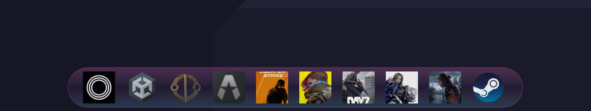

## Capturas

| | |
| --- | --- |
| 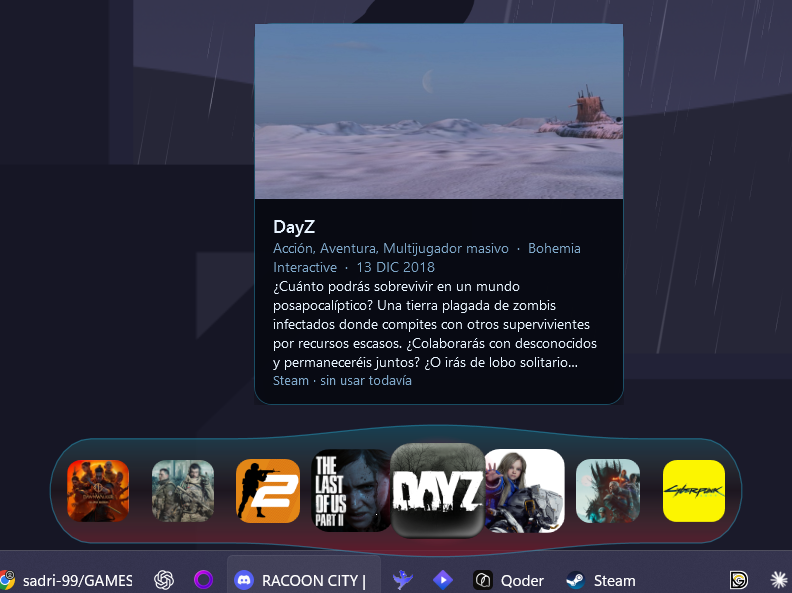 | **Magnificado estilo macOS.** El icono bajo el cursor crece y sus vecinos lo hacen de forma decreciente; la píldora se estira con él. El tooltip dice de dónde salió el acceso, cuántas veces se ha lanzado y dónde está. |
| 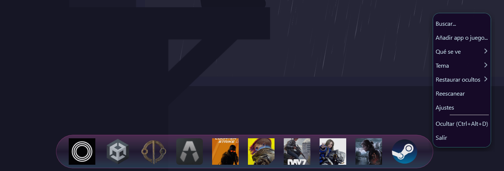 | **Todo por el clic derecho.** Buscar, añadir, elegir qué se ve, el tema, restaurar ocultos, reescanear y ajustes —en las dos puntas vacías de la barra, no en los iconos—. Sin cuadros ni engranajes a la vista. |
| 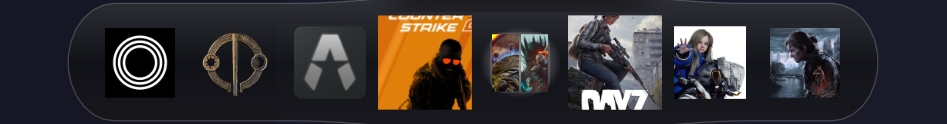 | **Carpetas como en iOS.** Se suelta un icono encima de otro y en ese hueco queda un mosaico con lo que hay dentro —aquí, Cyberpunk 2077 y The Witcher 3—, no un dibujo de carpeta. |
| 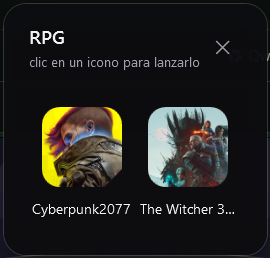 | **Al pincharla sale el contenedor**, pegado a la barra y centrado en su hueco: el título del grupo arriba —que solo se ve ahí—, los iconos con su nombre debajo, y un clic en cualquiera lo lanza y cierra el contenedor. |
| 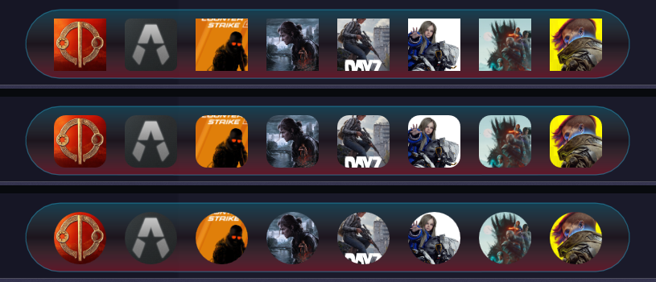 | **La forma del icono.** La misma fila, la misma config y los mismos PNG recortados de tres maneras: cuadrada por defecto, cuadrado suavizado tipo iOS, o esfera. Se cambia en los ajustes y se aplica a todo, carpetas incluidas. |
| 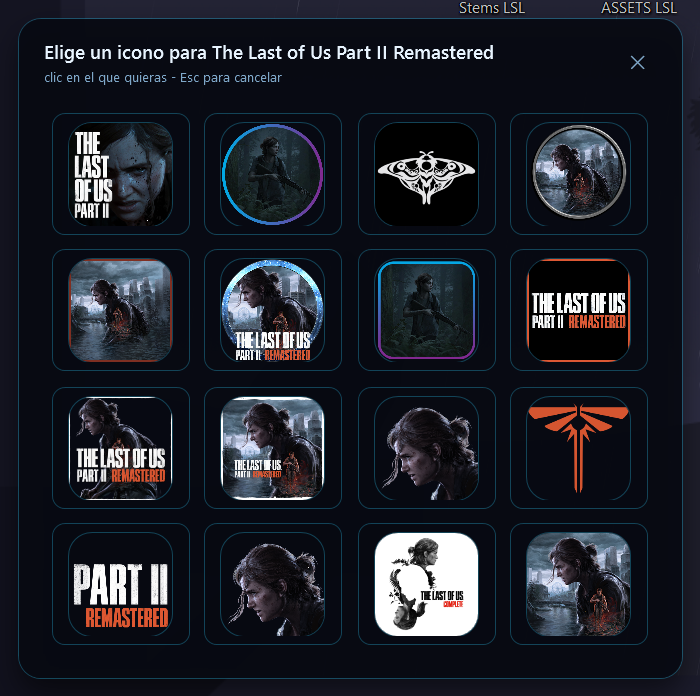 | **Iconos de la comunidad.** Clic derecho sobre un tile → *Iconos de la comunidad*: la rejilla con las miniaturas que la gente subió a SteamGridDB, ordenadas por la puntuación que le da quien las usa. Un clic en cualquiera la baja, la guarda y pinta ese dibujo en el hueco del juego. |
| 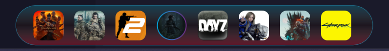 | **Y así queda la barra** —la misma fila, con los dibujos elegidos en su hueco; el PNG se recorta con la forma que esté puesta en Ajustes—. |
| 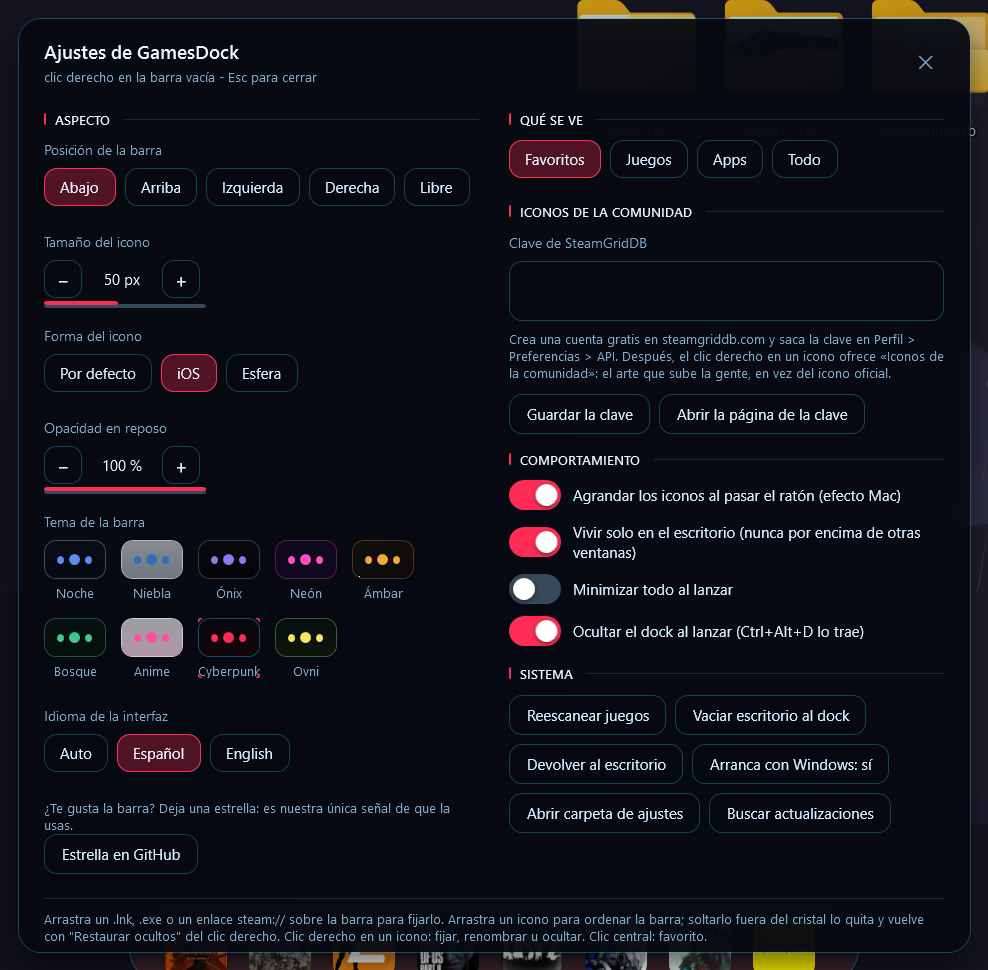 | **Ajustes.** Posición, tamaño y forma del icono, opacidad en reposo, los nueve temas con su muestra de color, el idioma de la interfaz, el campo donde se pega la clave de SteamGridDB, las filas de sistema —con **Buscar actualizaciones**— y, abajo del todo, la fila para dejar una estrella en el repositorio. |
| 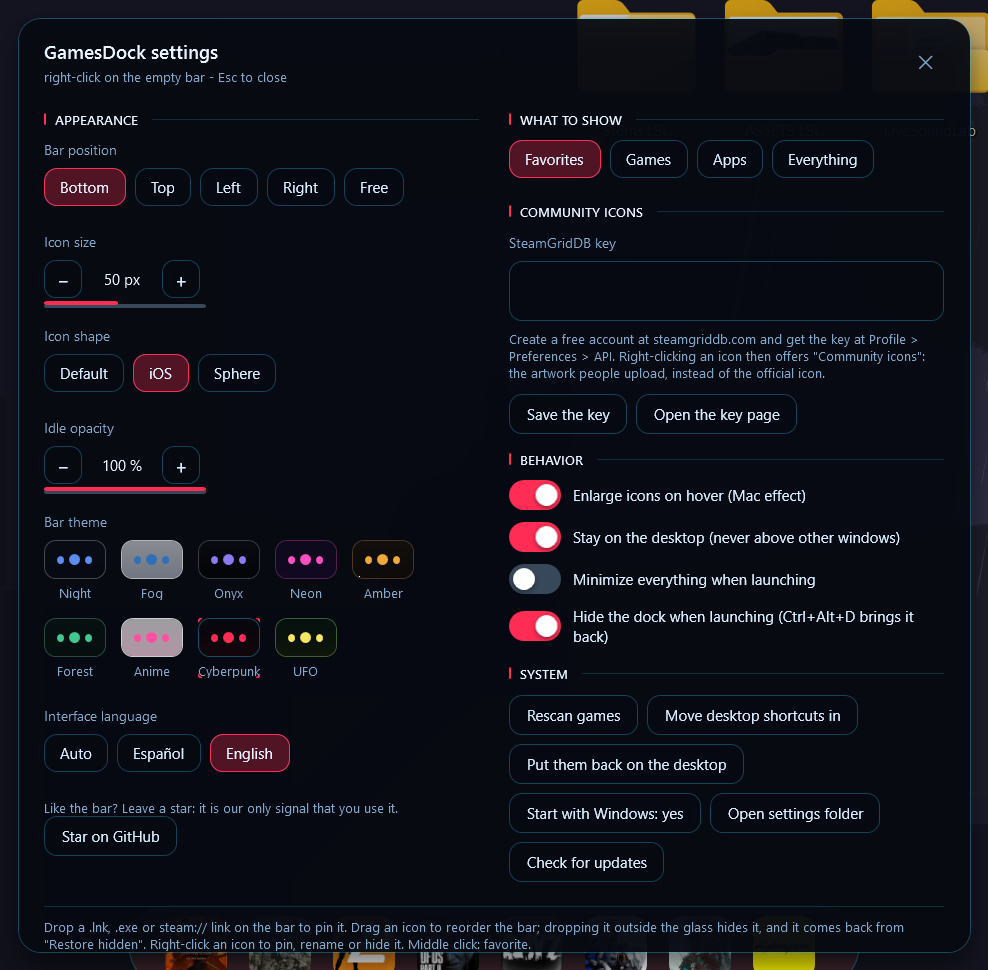 | **Y en inglés**, cambiándolo en caliente: la ventana se reescribe sin reiniciar la barra. |
| 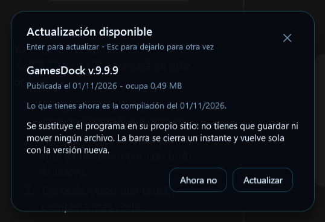 | **Cuando hay versión nueva.** Un panel de cristal con el título del release, cuándo se publicó, lo que ocupa y la fecha de la compilación que tienes delante. Da a **Actualizar** y se cambia él solo, sin que guardes ni muevas nada. *(La captura es contra el servidor de pruebas del arnés, por eso ofrece una `v.9.9.9`.)* |

## Qué hace

- **Detecta los juegos sin que muevas un dedo**: Steam (biblioteca y atajos), Epic Games (manifiestos
  de instalación), GOG, el menú Inicio —del usuario y de todos los usuarios— y los accesos del
  escritorio. Deduplica por destino y clasifica cada entrada como juego o aplicación.
- **Pone la cara de cada juego**: el arte de Steam se busca en `appcache\librarycache`, y como el
  cliente nuevo lo guarda en subcarpetas con nombre-hash, la búsqueda recorre ese nivel y puntúa los
  ficheros por nombre en vez de exigir la ruta literal.
- **Acepta lo que tú le des**: suelta un `.exe`, un `.lnk`, un `.url` o un enlace `steam://` sobre la
  barra y queda fijado, con su icono real extraído en alta resolución y cacheado en disco. Y si el que
  trae no te gusta, «Cambiar icono…» coge cualquier PNG, JPG, ICO o EXE del disco.
- **Iconos de la comunidad (SteamGridDB)**: «Iconos de la comunidad» en el menú de un icono busca el
  juego solo —por su app id de Steam si el acceso sale de Steam, y por el nombre del tile en cualquier
  otro caso—, abre una rejilla con las miniaturas que la gente ha subido para ese juego, ordenadas por
  puntuación, y al pinchar una la baja y la pinta en la barra. No hay que escribir ningún nombre ni
  pasar por un cuadro de guardado, y el resto de la barra sigue funcionando mientras se descarga.
  Pide una clave gratuita de SteamGridDB, que se pega en Ajustes: se explica en
  [Iconos de la comunidad](#iconos-de-la-comunidad-steamgriddb).
- **Carpetas como en iOS**: suelta un icono encima de otro y se convierten en una carpeta. En la barra
  es un mosaico con los iconos de dentro —se redibuja cada vez que cambia el contenido—, y al pincharla
  sale un contenedor con esos iconos y sus nombres. Su título solo se ve ahí dentro; en la barra manda
  el mosaico.
- **Magnificado estilo macOS** al pasar el ratón, con caída suave hacia los vecinos y la píldora
  creciendo al ritmo del icono agrandado. Los iconos de las puntas se agrandan enteros: el cristal se
  recorta en el momento, no por un margen fijo que los cortaba.
- **Se comporta como parte del escritorio**: ventana `WS_EX_NOACTIVATE` colocada al fondo de la
  z-order, de modo que cualquier ventana —incluso a pantalla completa— la tapa y nunca le roba el foco
  a lo que estés usando.
- **Se oculta al lanzar** (y vuelve con el atajo de teclado), minimiza todo al lanzar si lo pides y
  deja un icono en la bandeja del sistema como acceso cuando está oculta.
- **Absorbe el escritorio**: un botón mueve los accesos de la mesa de trabajo a la barra y otro los
  devuelve exactamente a donde estaban.
- **Se actualiza solo, pero pregunta antes**: a los ocho segundos de arrancar —y cuando tú pulses
  «Buscar actualizaciones» en Ajustes— mira la página de releases del repositorio. Si hay una publicación
  más nueva que el ejecutable que tienes delante, sale un panel de cristal con la versión, su fecha y lo
  que ocupa, y dos botones. Si confirmas, se baja el `.exe` nuevo, se cambia en su propio sitio y se borra
  todo el rastro; no hay que guardar ni mover nada a mano. Se explica en
  [Actualizaciones](#actualizaciones).
- Instancia única por mutex nominal, estado en un único `config.json` y bitácora autolimitada.

## Cómo se maneja

| Gesto | Resultado |
| --- | --- |
| `Ctrl` + `Alt` + `D` | Mostrar / ocultar la barra |
| Doble clic en el icono de la bandeja | Mostrar / ocultar la barra |
| Clic derecho en el hueco libre de la píldora | Menú: Buscar…, Añadir app o juego…, Qué se ve, Tema, Restaurar ocultos, Reescanear, Ajustes, Ocultar, Salir |
| Clic derecho sobre un icono | Favorito, Lanzar ahora, Abrir carpeta del juego, Renombrar, Cambiar icono…, Iconos de la comunidad, Quitar/Ocultar del dock |
| Clic derecho sobre una carpeta | Abrir el grupo, Renombrar, Desagrupar, Ocultar del dock |
| Clic fuera del menú desplegado | Cierra el menú sin activar lo que haya debajo |
| Clic central sobre un icono | Marcar o desmarcar como favorito |
| Arrastrar la píldora por su cristal —el trozo que no tiene iconos— | Al soltarla se ancla al borde más cercano: abajo, arriba, izquierda o derecha. En posición «Libre» no hay imán y se queda donde la sueltes |
| Arrastrar un archivo hasta la píldora | Fijarlo en la barra |
| Arrastrar un icono dentro de la barra | Reordenar la fila |
| Soltar un icono encima de otro | Crece una carpeta con los dos dentro |
| Clic en la carpeta | Se abre el contenedor con los iconos de dentro y sus nombres |
| Clic o `Esc` fuera del contenedor | Lo cierra, sin lanzar nada |
| Clic en un icono del contenedor | Lo lanza y cierra el contenedor |
| Clic en una miniatura del selector | Baja ese icono, lo pone en el tile y cierra el selector |
| `Esc` o la cruz en el selector | Lo cierra sin cambiar el icono que había |
| `Enter`, `Esc`, la cruz o «Vale» en un aviso | Lo cierra; la barra de detrás sigue animando mientras está abierto |
| «Abrir ajustes» en el aviso de sin clave | Cierra el aviso y abre Ajustes en la sección de Iconos de la comunidad |
| `Enter` en el panel de actualización | Baja la versión nueva, cambia el programa y relanza la barra |
| `Esc` en ese panel | Lo cierra sin más: la misma versión volverá a ofrecerse al siguiente arranque |
| «Ahora no» en ese panel | Lo cierra y apunta esa versión para no volver a sacarla al arrancar |
| «Buscar actualizaciones» en Ajustes | Comprueba las releases en el momento, aunque la versión estuviera apuntada como rechazada |
| «Estrella en GitHub» en Ajustes | Abre la página del repositorio en el navegador —es lo que hay si la barra te sirve y quieres que se sepa— |
| Soltar un icono fuera del cristal | Ocultarlo; vuelve desde «Restaurar ocultos» |

No hay cuadro de búsqueda, filtros ni engranajes a la vista: la barra es una píldora limpia y todas
esas opciones entran por el menú del clic derecho o por la ventana de Ajustes.

Al arrastrar la píldora por su cristal, el punto donde se ancla al soltarla es **el mismo rectángulo
que pone la chip de posición en Ajustes** —abajo, arriba, izquierda o derecha—, elegido por el borde
al que le queda menos desde donde la sueltas; en una esquina manda el hueco más corto, así que la barra
no se va de lado cuando la dejas a medio camino. Con la posición en «Libre» el imán no entra y la píldora
se queda píxel a píxel donde la soltaste. Lo uno y lo otro se recuperan igual al arrancar.

El desplegable se cierra con un clic en cualquier punto de la pantalla que no sea el propio menú —el
escritorio, otro icono, otra ventana—, igual que cualquier menú de Windows. Y ese clic no llega a la
ventana que hay debajo: se retira para que no dispare nada por accidente.

Mientras hay una ventana de por medio —Ajustes, el cuadro de renombrar, un aviso— la pantalla se cubre
con un velo tenue (negro al 22 %) que se come todos los clics de fuera: imposible pinchar un icono o
otra ventana mientras el programa espera una respuesta. El velo no roba el foco —el cuadro de texto
sigue escribiendo— y se quita solo cuando se cierra el emergente, sea con Guardar, Enter, `Esc` o la
cruz. El contenedor de una carpeta no es modal: se cierra pinchando fuera o con `Esc`.

## Qué se puede personalizar

- **Posición**: abajo, arriba, izquierda, derecha o libre en cualquier punto de la pantalla. Las cuatro
  fijas se eligen por chip o arrastrando la barra hasta ese borde y soltándola: los dos caminos acaban en
  el mismo rectángulo. Con «Libre» no hay imán.
- **Tamaño del icono**: 28 – 76 px.
- **Forma del icono**: por defecto (el cuadrado de siempre), iOS (cuadrado con la esquina suavizada)
  o esfera. Es solo el recorte con el que se pinta: el PNG no se sustituye ni se reescala, y las
  carpetas entran en el mismo molde que las apps.
- **Opacidad en reposo**: 10 – 100 %, con la barra recuperando opacidad completa al hover.
- **Sección visible**: Favoritos, Juegos detectados, Aplicaciones o Todo.
- **Icono propio**: cualquier fijado puede llevar un PNG, JPG, ICO o EXE que elijas —o uno de los que
  sube la comunidad de SteamGridDB, por «Iconos de la comunidad»—, y se vuelve al original con «Quitar
  icono personalizado». Los dos caminos acaban en la misma carpeta y en la misma entrada del config, así
  que la limpieza es idéntica.
- **Clave de SteamGridDB**: se pega en Ajustes → *Iconos de la comunidad* y se queda en tu `config.json`;
  si además la tienes en la variable de entorno `STEAMGRIDDB_KEY`, esa gana y el campo no hace falta.
  Es la única credencial que guarda el programa, y hace falta porque el API de SteamGridDB no admite
  peticiones anónimas: se explica en [Iconos de la comunidad](#iconos-de-la-comunidad-steamgriddb).
- **Carpetas**: su título —el que escribas, o el de lo primero de dentro— solo se ve dentro del
  contenedor; el mosaico de la barra se compone solo con lo que haya dentro en cada momento.
- **Nueve temas**: Noche, Niebla, Onix, Neón, Ámbar, Bosque, Anime (blanco y rosa), Cyberpunk (rojo,
  negro y azul) y Ovni (verde y amarillo).
- **Idioma de la interfaz**: automático —el del sistema—, español o inglés. Se cambia en caliente
  desde los ajustes: menús, bandeja y ventana de ajustes se reescriben sin reiniciar.
- **Comportamiento**: magnificado, vivir solo en el escritorio, minimizar todo al lanzar, ocultar al
  lanzar y arrancar con Windows.

## Iconos de la comunidad (SteamGridDB)

[SteamGridDB](https://www.steamgriddb.com) es una biblioteca pública de arte de videojuegos hecha por la
comunidad: para un mismo juego hay decenas de versiones subidas por la gente —logos sueltos sobre fondo
transparente, recortes, arte con estilo propio—, cada una con la puntuación que le da quien la usa. GamesDock
enseña esa lista dentro de la barra y pinta la que tú elijas en el hueco del juego, sin salir de la píldora y
sin pasar por un cuadro de guardado.

Es la única función del programa que pide una credencial. Lo que abre la red son esto y la
[comprobación de actualizaciones](#actualizaciones), que no manda ningún dato tuyo.

### Los tres pasos

1. **Saca tu clave.** Con una cuenta gratis en steamgriddb.com: **Perfil → Preferencias → API → Generate API
   key**. La página exacta es <https://www.steamgriddb.com/profile/preferences/api>, y el botón «Abrir la
   página de la clave» de los ajustes te lleva ahí directamente.
2. **Pégala en Ajustes.** Clic derecho en el hueco libre de la píldora → **Ajustes** → sección
   *Iconos de la comunidad* (el segundo bloque de la columna derecha, para que no haya que desplazar nada):
   el campo «Clave de SteamGridDB», y **Guardar la clave** —o `Enter` dentro del campo, que hace lo
   mismo—. El botón cambia a «Clave guardada» y el valor se escribe en `steamGridKey` de tu
   `%APPDATA%\GamesDock\config.json`. Si prefieres no escribir nada, la variable de entorno
   `STEAMGRIDDB_KEY` gana y el campo sobra.
3. **Pide el icono.** Clic derecho sobre un tile → **Iconos de la comunidad**. Sale una rejilla con las
   miniaturas ordenadas por puntuación de la comunidad; un clic en cualquiera la baja, la reescribe a PNG,
   la guarda en `%APPDATA%\GamesDock\icons\custom\` y repinta el tile. `Esc` o la cruz cierran el selector sin
   tocar el icono que había, y «Quitar icono personalizado» revierte al original.


Mientras se descarga, la barra sigue respondiendo: las peticiones van en `async` y el magnificado no se para.
La lista puede tardar —SteamGridDB no siempre contesta en menos de veinte segundos, y la barra aguanta
hasta cuarenta y cinco antes de dar la petición por perdida—; el subtítulo del selector lo advierte y las
miniaturas van apareciendo solas, cuatro a la vez, sin bloquear nada.

### Por qué hace falta una clave propia

Porque SteamGridDB no contesta a nadie sin credencial. El API v2 exige `Authorization: Bearer <clave>` en
**todas** sus rutas —la búsqueda por nombre, la lista de iconos y la descarga—; sin cabecera la respuesta es
`401` con `{"success":false,"errors":["Authentication Required"]}`, y no hay forma de que la app la salte
por su cuenta. No hay un camino anónimo: las rutas `…/api/public/…` que se citan por ahí responden `404` con
la web delante, y el viejo `api.steamgriddb.com` ni siquiera resuelve. Lo único público de verdad es el CDN de
la propia Valve, que sirve la carátula oficial del juego —justo lo que la barra ya saca de `librarycache` sin
pedir nada—. El arte de la comunidad, que es lo que aporta esta función, solo sale autenticado.

Y la clave tiene que ser tuya, no del programa:

- **Un `.exe` público no guarda secretos.** GamesDock se distribuye como un único binario managed compilado
  con `csc`: cualquiera que lo descargue puede leer las constantes de su IL con un decompiler en un paso, sin
  depurador. Una clave embebida dejaría de ser una clave en cuanto alguien subiera el exe a cualquier sitio.
- **Y quedaría para siempre en el historial de git.** Borrarla en un commit posterior no la borra: vive en
  cada objeto del histórico de un repositorio público.
- **El gasto lo paga quien la registró.** Las claves están atadas a una cuenta y su uso se contabiliza ahí.
  Una clave compartida entre todos los usuarios de la barra se agota o se revoca, y entonces el botón deja de
  funcionar para todo el mundo a la vez, sin que nadie pueda hacer nada.
- **Cifrarla dentro del binario no la protege.** Para usarla el programa tiene que descifrarla, así que el
  secreto que la abre tiene que estar en el mismo binario. Eso es ofuscación: sube el listón de «leer una
  cadena» a «un paso más», y nada más. DPAPI (`ProtectedData`) solo cifra *en reposo* para el usuario de
  Windows que descifra; en tiempo de ejecución el proceso sigue teniendo la clave en claro, así que no
  resolvería lo anterior —y aquí la clave ya es por usuario, con lo que el campo del config es suficiente—.

¿Y qué se gana con registrarse y pegar cuatro caracteres? La cara de cada juego elegida entre las versiones
de la comunidad en vez de conformarse con la carátula oficial, y el control de lo que sale de la máquina: el
app id o el nombre del tile, hacia un solo host, solo cuando tú pulsas el botón.

**Sin clave no pasa nada más.** El botón muestra un aviso de cristal —no un `MessageBox`— que dice dónde
sacarla y dónde se pega, con un botón «Abrir ajustes» que deja el panel delante con la sección a la vista. El
resto de la barra no se entera: fuera de esta función y de la comprobación de versiones no hay ninguna ruta
del programa que toque la red.

## Actualizaciones

GamesDock se distribuye como un único `.exe`, así que actualizarse es cambiar ese archivo. La barra lo hace
sola —con tu permiso— y sin que tengas que descargar ni mover nada tú.

### Cuándo pregunta

- **Al arrancar**, ocho segundos después de pintarse la píldora: lo justo para no montarte un panel encima
  mientras Windows aún está cargando. Si no hay nada nuevo —o no hay red— no dice nada.
- **Cuando tú quieras**: clic derecho en el hueco libre → **Ajustes** → **Buscar actualizaciones**.

Si hay una publicación más nueva sale un panel de cristal —no un cuadro de Windows— con el título del
release, la fecha en que se publicó, lo que ocupa en megabytes y la fecha de la compilación que tienes
delante. **Actualizar** empieza el cambio; **Ahora no** lo cierra y anota esa versión en el `updateIgnored`
del config para no volver a sacarla al arrancar. Cerrarlo con `Esc` o con la cruz no anota nada: al
siguiente arranque volverá a preguntar. El botón de Ajustes pregunta siempre, incluso con la versión
apuntada como rechazada.

### Cómo decide qué es «más nuevo»

Por **fechas, no por números**: la publicación manda si su `published_at` de GitHub es posterior al día y la
hora de escritura del ejecutable que está en marcha, con cinco minutos de aire para que un «acabo de
compilar y acabo de publicar» no cuente como novedad. El programa no lleva número de versión —ni en el
código, ni en el ensamblaje, ni en un fichero aparte— a propósito: la copia que se compila del repositorio
es la de desarrollo, y un número escrito a mano queda desfasado en cuanto alguien compila, con lo que la
comparación mentiría. El título del release —`GamesDock v.1.0.1`, por ejemplo— solo sirve para enseñártelo,
y en el config no se guarda más que ese título cuando rechazas una versión.

### Qué hace falta para publicar una versión

1. Compilar con `app\build.ps1` y subir el `app/GamesDock.exe` resultante como **asset** del release.
2. Que el release traiga ese asset llamado `GamesDock.exe`: es lo que se baja. Si no lo hay pero el release
   tiene cualquier otro `.exe`, se usa ese; si no hay ningún `.exe`, la barra no ofrece nada.
3. Publicar **después** de la última compilación que repartas. Si la fecha de publicación es anterior a la
   del archivo que la gente ya tiene, la barra lo da por puesto y no lo ofrece.

### La instalación no deja rastro

1. Se baja el ejecutable a `%APPDATA%\GamesDock\update\GamesDock.exe`. Esa carpeta no existe en una barra sin
   actualizar —no se crea al arrancar— y se borra entera al terminar el cambio.
2. Se comprueba lo bajado antes de tocar nada: que pese lo que anunció GitHub, que empiece por la firma `MZ`
   y que pase de 4 KiB. Así una página de error o una descarga cortada no sustituyen tu programa.
3. Windows no deja sustituir el `.exe` que se está ejecutando, así que el cambio se encarga a un `.cmd` de
   una sola vez escrito en `%TEMP%`: la barra se cierra, el script reintenta el `move` unos segundos, borra
   la carpeta `update\`, vuelve a lanzar GamesDock y se borra a sí mismo.
4. Si la carpeta del programa no se puede escribir —en `Program Files` sin permisos, por ejemplo—, el panel lo
   dice y no se toca nada. El archivo de la descarga se barre al arranque siguiente.

### Verificado

`_dev/cs-upd.ps1` levanta `_dev/cs-upd-srv.ps1` en `127.0.0.1:8778`, que imita la página de releases de GitHub
—incluidos el `404` de un repositorio sin releases y el servidor apagado— y ofrece un ejecutable con una
marca pegada al final, para poder distinguir después el archivo instalado del de la compilación. La tanda
recorre el panel del arranque y el de Ajustes, el `Esc` que no guarda rechazo y el «Ahora no» que sí, el
silencio del arranque siguiente, la regla de fechas, **la instalación de verdad** —archivo cambiado, barra
relanzada sola, sin quedar la carpeta `update\` ni el `.cmd` del encargo ni un archivo de más en la carpeta
del programa— y los dos fallos de red. Última pasada: 76 comprobaciones, 0 fallos.

## Dónde guarda sus cosas

Se queda íntegramente en el perfil de usuario. El registro solo se lee, nunca se escribe.

| Ruta | Contenido |
| --- | --- |
| `%APPDATA%\GamesDock\config.json` | Ajustes —incluido el idioma, la clave de SteamGridDB y la versión de actualización que has rechazado—, fijados, orden, favoritos, usos, grupos y mapa de accesos movidos |
| `%APPDATA%\GamesDock\dock.log` | Bitácora de arranque, detección, actualizaciones y errores; se vacía al superar 256 KiB. Nunca guarda la clave: dice si se guardó, no cuál es |
| `%APPDATA%\GamesDock\icons\` | Caché de iconos en PNG de 256 px |
| `%APPDATA%\GamesDock\icons\custom\` | Copia del icono propio de cada fijado, con nombre-hash; aquí cae también el PNG que baja «Iconos de la comunidad». Si borras el original, el tile no se queda vacío |
| `%APPDATA%\GamesDock\escritorio\` | Copias de los accesos movidos desde el escritorio |
| `%APPDATA%\GamesDock\update\` | Solo durante una actualización: el ejecutable bajado mientras espera a poder sustituir el viejo. Se borra entera al terminar, así que en una barra sin actualizar ni siquiera existe |
| `%APPDATA%\GamesDock\GamesDock.lanzador.vbs` | Solo si activas «Arranca con Windows» |
| `%STARTUP%\GamesDock.lnk` | El acceso de arranque, que ejecuta el `.vbs` anterior con la ventana oculta |

Borrar `%APPDATA%\GamesDock` deja la aplicación como recién instalada; lo único que puede quedar es
el acceso de `%STARTUP%` si activaste el arranque con Windows. El único sitio fuera de esa carpeta que
toca la barra es `%TEMP%`, y solo durante una actualización: el `.cmd` que hace el cambio, que se borra a
sí mismo en cuanto lo hace.

## Compilar desde el código

Requisitos: Windows 10 u 11 x64 con **.NET Framework 4.8** (ya viene con el sistema) y las **Build
Tools de Visual Studio 2022 o superior**, que son las que aportan el compilador Roslyn. No hace falta
el SDK de .NET ni los *targeting packs*.

```powershell
powershell -NoProfile -ExecutionPolicy Bypass -File app\build.ps1
```

`build.ps1` invoca a `csc.exe` directamente —no hay proyecto MSBuild— y produce
`app/GamesDock.exe`. Detalles que conviene saber antes de tocar el build:

- Se referencian los ensamblajes de WPF del propio runtime
  (`C:\Windows\Microsoft.NET\Framework64\v4.0.30319\WPF\*.dll`) y `System.Xaml` de la raíz de esa
  carpeta. Esa asimetría es real, no una errata.
- **Nunca** uses `C:\Windows\Microsoft.NET\Framework64\v4.0.30319\csc.exe`: es el compilador *legacy*,
  se detiene en C# 5 y rechaza parte del código.
- Los dos ficheros XAML y el icono se empotran como recursos administrados del ensamblaje y se parsean
  en tiempo de ejecución, así que no hay BAML ni generador de marcado.
- El icono se incluye dos veces: como `RT_GROUP_ICON` del PE (`-win32icon`, para el explorador) y como
  recurso gestionado (para la bandeja, que pide una variante pequeña).
- La compilación sale con **cero avisos**.

## Estructura del repositorio

```
app/
  build.ps1          compilación de un solo fichero (la única herramienta necesaria)
  app.manifest       DPI PerMonitorV2 y asInvoker: se ejecuta sin elevación
  icon.ico           icono del programa, con todas sus variantes de tamaño
  src/               27 ficheros .cs, todos en el namespace GamesDock
    Program.cs       arranque, instancia única, cableado de la ventana principal
    Foundation.cs    rutas, bitácora, TLS y recorte de memoria
    Config.cs        modelo de configuración y su persistencia JSON
    Lang.cs          tabla de traducción es → en y selección de idioma
    Catalog.cs       detección e índice de juegos y aplicaciones
    Dock.cs          ventana píldora: tiles, temas y pintado
    Dock.Interact.cs hover, arrastre, menús contextuales, soltar archivos y el flujo de la comunidad
    EdgeSnap.cs      el imán de bordes: qué posición fija queda más cerca del punto donde se soltó
    Groups.cs        agrupar, fusionar, desagrupar y vaciar carpetas
    GroupPanel.cs    el contenedor que se abre al pinchar una carpeta
    MenuGuard.cs     que el desplegable se cierre al pinchar fuera
    Veil.cs          velo a pantalla completa mientras hay un emergente abierto
    Springs.cs       motor de muelles sincronizado con el compositor
    Layout.cs        toda la geometría de la píldora
    PillGeometry.cs  construcción del contorno de la píldora
    Ghost.cs         icono flotante que sigue al cursor durante el arrastre
    Icons.cs         extracción y caché de iconos, incluidos los propios
    SteamGrid.cs     cliente del API v2 de SteamGridDB: buscar el juego, listar iconos y bajarlos
    IconPicker.cs    la rejilla de miniaturas con la que se elige el icono de la comunidad
    Themes.cs        definición de los nueve temas
    Tray.cs          bandeja del sistema y atajo global
    Settings.cs      ventana de ajustes —campo de clave incluido—, sus avisos y la absorción del escritorio
    Update.cs        cliente de la página de releases: preguntar la última, bajar el exe y encargar el cambio
    UpdateUI.cs      el panel de oferta con los megabytes, el aviso y lo que hace cada botón
    Shell.cs         lanzar, minimizar todo, accesos .lnk y arranque con Windows
    Native.cs        P/Invoke justos (atajo global, working set, gancho de ratón y primer plano)
    XamlAssets.cs    carga de los XAML empotrados
  xaml/              diccionario de estilos y ventana, parseados en runtime
  GamesDock.exe      binario compilado (se versiona a propósito: es el producto)
docs/
  logo.png           el logotipo de arriba, cortado del fotograma PNG de 256 px que lleva icon.ico
  screenshots/       las capturas de arriba, tomadas de la barra real
LICENSE, README.md, .gitattributes, .gitignore
```

Todos los ficheros de `src/` comparten el namespace `GamesDock` y se compilan con
`-langversion:latest` contra .NET Framework 4.8.

## Cómo está hecho

- **Nada de animaciones por temporizador.** Los muelles se integran contra el reloj del compositor:
  el motor engancha `CompositionTarget.Rendering` mientras algo se está moviendo y lo desengancha al
  asentarse. Por eso en reposo el proceso no ejecuta ni un cuadro de animación.
- **Medido en la máquina de desarrollo** (1920 × 1080 al 125 %, 12 iconos fijados, índice de 68
  elementos): CPU en reposo entre 0,01 % y 0,2 % normalizado a 12 hilos, con el recuento de handles
  estable y sin crecimiento de memoria tras dejar la barra tranquila. El *working set* ronda los
  17 MB en reposo prolongado y sube a ~67 MB justo después de interactuar, cuando la caché de iconos
  está caliente. Durante el barrido de hover el consumo no pasa de ~2,3 %.
- **El índice se construye en segundo plano**, con prioridad `Background` del despachador: la píldora
  se pinta antes de que termine el recorrido del registro y del menú Inicio.
- **Nivel de escritorio, no hijo del `WorkerW`.** La barra es una ventana de nivel superior
  `WS_EX_TOOLWINDOW` + `WS_EX_NOACTIVATE`, colocada en `HWND_BOTTOM` tras cada `Show()`. La otra
  opción —re-parentarla al `WorkerW`/`Progman` del escritorio con `SetParent`— quedó probada y
  descartada: la ventana con `AllowsTransparency` dejaba de pintar y de recibir clics.
- **El imán de los bordes vive fuera del dock, en `EdgeSnap.cs`.** Recibe el punto donde se soltó el
  botón y el área de trabajo, y devuelve cuál de las cuatro posiciones fijas queda más cerca; los cuatro
  huecos salen por `out` para que el arnés pueda contar por qué ganó ese borde. Se juzga la mano y no el
  rectángulo de la barra por una razón práctica: con la barra puesta «Abajo» quedan 6 px hasta ese borde,
  así que midiendo el rectángulo arrastrarla hacia la derecha no la cambiaría de lado ni sacándola medio
  monitor fuera. El empate resuelve abajo —la posición por defecto—, y de ahí arriba, izquierda y derecha.
  El punto de sueltado se pregunta a Windows (`GetCursorPos` pasado a DIP con `TransformFromDevice`), no a
  WPF: al salir de `DragMove` el ratón de WPF devuelve `0,0`, que es la esquina de arriba a la izquierda de
  la ventana, y por ahí el imán anclaría al borde que tocara por accidente. Lo que se aplica al soltar no
  es «cerca de ese borde» sino `Cfg.Position` a secas, la misma variable que escribe la chip de Ajustes,
  así que los dos caminos dejan la píldora píxel a píxel en el mismo rectángulo. Con la posición en «Libre»
  `SnapAlSoltar` sale sin consultar al imán.
- **La estrella de Ajustes abre el navegador, no un formulario.** La última fila del panel es la misma
  `Pill` de siempre, y su acción es `Launcher.OpenUrl(Update.PaginaRepo)` —el mismo `ShellExecute` que usa
  el botón de la página de la clave—: sale por la vía normal de Windows, así que se lo lleva el navegador
  que esté puesto y la barra no registra nada. `Update.PaginaRepo` es la única cadena del repositorio que
  conoce el programa, y es la que ya usa el actualizador para leer las releases.
- **La config respeta el esquema de las versiones anteriores**, así que una instalación existente sigue
  funcionando sin migración; los campos ausentes conservan su valor por defecto. Los grupos son una
  clave nueva y opcional: un `config.json` sin `groups` se comporta exactamente igual que antes.
- **Una carpeta no es un fijado nuevo: es un tile virtual.** En `order` entra la clave `group:<id>` —y
  si no está, la carpeta se sienta directamente en el hueco de su primer miembro—, mientras los
  miembros siguen siendo pins normales, cada uno con sus propios datos. Por eso desagrupar no pierde
  nada —los iconos vuelven a la fila donde estaban— y por eso el mosaico puede redibujarse en cada
  cambio sin tocar el catálogo. El mosaico se compone en `Groups.cs`, que es el único sitio donde se
  mutan los grupos; toda operación termina en `Save + Refresh`, así que lo que se ve en la barra es
  siempre lo que hay dentro en ese momento.
- **La forma del icono es un recorte, no un icono nuevo.** `Layout.cs` guarda las tres curvas
  (`TileRadius`, `BadgeRadius`, `FolderRadius`) a partir de `config.iconShape`, y el PNG se sigue
  cargando entero: cambiar de forma no toca ni un archivo de `icons\`. Con «esfera» el radio se manda
  a tope y WPF lo ajusta solo a media casilla. El detalle que no era evidente: WPF recorta el
  `Background` de un `Border` a su `CornerRadius`, pero **no recorta a su hijo** —por eso el mosaico de
  una carpeta se redondea celda a celda (`MosaicRadius`, que pone el radio en la esquina de fuera de
  cada celda) en vez de confiar en el borde contenedor, y por eso no se usó un `Clip` geométrico: un
  clip de geometría manda el tile a la vía lenta de render justo cuando el magnificado lo está moviendo
  cuadro a cuadro—.
- **Dos valores que dejaron de ser ajuste.** La holgura de la píldora queda fija en 4 px
  (`Layout.PadFix`): era el punto donde la fila se ve asentada sin que el cristal coma halo, y su
  efecto apenas se apreciaba. Y una config escrita por versiones anteriores puede traer `pillPad`: se
  ignora al leer y deja de escribirse en el primer guardado, sin migración. `iconShape` es opcional
  igual que `groups` —cualquier valor que no sea `ios` o `esfera` vale tanto como no tenerlo: el
  cuadrado de siempre—.
- **Agrupar y reordenar se distinguen por una banda de tres zonas** alrededor del icono vecino, medida
  sobre su centro real (`Dock.Interact.cs`): ±mitad del icono → se marca la carpeta; el hueco entre ese
  límite y el borde del slot → zona muerta, no hace nada, que es lo que antes convertía cualquier roce
  en un reordenamiento; pasado el centro → se mueve el slot. Las tres rutas están cubiertas por el
  arnés `_dev/cs-orden.ps1`.
- **El contenedor de la carpeta no es modal** —se cierra pinchando fuera o con `Esc`—, pero pide el
  primer plano al abrirse. El clic que lo saca recae en la píldora, que es `WS_EX_NOACTIVATE` y nunca
  pierde la activación, así que Windows no le soltaba el foco al panel y el `Esc` se quedaba en la
  ventana de atrás. Antes de cerrarse solo, mira si hay un menú o el velo del renombrar por medio.
- **El recorte del extremo se arregló con geometría, no con un margen mayor.** El `ScrollViewer` de la
  fila recorta justo en el borde del cristal, que es donde el icono del extremo más se agranda; la
  ventana del viewport sale `MagOverrun` hacia fuera y la `Strip` vuelve a entrar esa misma distancia,
  así que el primer icono sigue empezando a `RowInset` del borde pero puede desbordarse. Se hace solo
  cuando la fila cabe entera: si desborda y se puede desplazar, recortar en el borde es lo correcto.
- **El velo es una ventana `Topmost` + `WS_EX_NOACTIVATE` + `WS_EX_TOOLWINDOW`** que tapiza todo el
  escritorio virtual y se come el ratón en sus tres eventos de vista previa. No roba el foco —si lo
  hiciera, el cuadro de renombrar dejaría de escribir a media frase— y su `Push`/`Pop` es un contador
  de profundidad, porque los diálogos se anidan (el explorador que abre «Cambiar icono…» nace con el
  velo ya puesto). Como no sabemos qué ventanas nuestras caerán por debajo, un temporizador de 150 ms
  las sube ocho intentos y se apaga; con el velo quitado, cada una vuelve a su banda normal. Sin velo
  el proceso no tiene ni ventana de velo ni temporizador. A qué ventanas sube se decide por **handle**,
  no por título: la píldora se anota en `Veil.Pildora` desde `Dock.SetDesktopLevel`. Antes se comparaba
  el título, y un aviso titulado como la app (`GamesDock`) pasaba por la píldora —que es la única a la
  que el velo jamás sube—, así que el aviso se quedaba debajo, ciego para el ratón, con el hilo de UI
  parado dentro de su propio cuadro modal. Eso era el congelamiento.
- **Los avisos son de cristal, no un `MessageBox` de Windows.** `Settings.Aviso` monta el mismo panel
  de los ajustes —título propio, texto envuelto y un botón «Vale»— y se cierra con `Enter`, `Esc`, la
  cruz o el botón. Un `MessageBox` nativo no es una ventana WPF: el velo no la conoce y no la sube, y
  su bucle modal deja el despachador del proceso fuera de juego, así que la barra detrás deja de
  animar. El aviso de «sin clave» añade un segundo botón, «Abrir ajustes», que se ejecuta **después**
  de que `ShowDialog` vuelva: abrir un modal dentro de otro anidaba dos velos.
- **El cuerpo de un panel de cristal se estira hasta lo que deja la pantalla.** `GlassPanel` tenía el
  techo fijo en 640 px, y la sección de la clave ya no cabía ahí: la última fila de los ajustes se
  cortaba y, como la barra de desplazamiento va oculta a propósito, no había ninguna pista de que
  debajo hubiera algo. Ahora el máximo sale de `SystemParameters.WorkArea`, acotado entre 420 y 760 DIP
  para que un portátil pequeño no saque una ventana kilométrica ni un monitor grande estire el aviso de
  dos líneas.
- **El icono propio se copia, no se referencia.** `Icons.InstallCustom` guarda un PNG de 256 px en
  `icons\custom` con nombre derivado de la clave del fijado, así que borrar o mover el archivo original
  no deja el tile vacío; si lo que se eligió era un binario, se guarda la extracción y no una copia del
  ejecutable entero.
- **Los iconos de la comunidad son tres piezas que no se conocen entre sí.** `SteamGrid.cs` es solo
  transporte (devuelve listas y bytes, sin tocar un solo control), `IconPicker.cs` solo enseña
  miniaturas y devuelve la url elegida, y la decisión de dónde guardar y a qué fijado afectar es de
  `Dock.Interact.cs`. Por eso el selector se prueba sin red y se reutilizaría igual desde otro sitio.
- **El API real no es el que publica la documentación.** `api.steamgriddb.com` ya no resuelve: el API v2
  cuelga del propio sitio (`www.steamgriddb.com/api/v2`), la autenticación es una clave estática en
  `Authorization: Bearer …` y buscar un nombre es `/search/autocomplete/<nombre>`, no el
  `/search/phrase/…` que aparece por ahí. Los iconos salen de `/icons/steam/<appid>` o
  `/icons/game/<id>` según el camino.
- **Se entra por el app id cuando lo hay**, que es coincidencia exacta; el acceso de Steam detectado ya
  lo trae, y un `.url` de `steam://rungameid/…` también. Si SteamGridDB no conoce ese id no es un error:
  es el motivo para continuar buscando por el nombre del tile. Ese nombre se limpia antes de pedirlo
  —«- Acceso directo», el `[Steam]` del escaneo y la extensión del archivo no ayudan a buscar y sí
  estorban en la URL—.
- **La lista llega ordenada por la puntuación de la comunidad**, deduplicada por url y sin las entradas
  que no traen imagen, con un tope de 60 fichas. La primera es la que se ofrece siempre, y el selector la
  pinta con el mismo radio que el resto de la barra: la miniatura va en el `Background` del `Border`, no
  como hijo, porque WPF recorta el fondo a su `CornerRadius` pero al hijo no.
- **La clave la pone cada uno, y solo hay un sitio donde se escribe.** Se mira primero la variable de
  entorno `STEAMGRIDDB_KEY` y luego `config.json` (`steamGridKey`); si tampoco hay, el aviso de «sin
  clave» abre Ajustes en la sección *Iconos de la comunidad*. Antes de esto el botón preguntaba la
  clave por su cuenta en un cuadro de texto: dos puertas para el mismo dato y ninguna explicación de
  dónde sacarla. El repositorio es público, así que el binario no puede llevar ninguna —ver
  [por qué hace falta una clave propia](#por-qué-hace-falta-una-clave-propia)—. La cabecera solo se
  manda al host del API; las miniaturas y el icono se piden al CDN pelados, que es público.
- **Lo que se descarga se normaliza una vez, no en cada pintado.** `ExtencionReal` mira la firma del
  contenido en lugar de fiarse de la cabecera o del nombre del archivo, un JPG o un ICO se reencodea a
  PNG y se escribe primero en `.tmp` para moverlo al final: si el corte es a media descarga el tile se
  queda con el icono anterior y no con un PNG truncado. El destino lo calcula `Icons.RutaPropia` con la
  misma clave del fijado, así que no hay cuadro de guardado y «Quitar icono personalizado» limpia
  también el de la comunidad sin código nuevo.
- **Las descargas del selector van en cuatro carriles y empiezan con la ventana ya creada**, porque los
  `await` vuelven al despachador del diálogo y sin ventana no hay a donde volver. Al cerrar, un
  `CancellationToken` corta las que estaban en vuelo; el contador de pendientes baja también cuando una
  miniatura falla, que es lo que hace que el aviso de «cargando» desaparezca siempre.
- **Está verificado contra un servidor local**, no contra la API de SteamGridDB: `_dev/cs-sgd-srv.ps1`
  levanta en `127.0.0.1:8777` el mismo formato de respuestas —incluidos el 401, la lista vacía y un
  cuerpo que dice ser imagen y no lo es— y `_dev/cs-sgd.ps1` recorre la barra de verdad: clic derecho,
  fila del menú, selector, ficha pinchada, píxel del tile, `config.json` y arranque otra vez. La barra
  apunta ahí mediante `GAMESDOCK_SGD_BASE`, que solo usa el arnés. Cubre también el arranque **sin
  clave** —el caso que congelaba la barra—: espera el aviso, comprueba que no hay ningún cuadro nativo
  (`#32770`) detrás, le da un clic de ratón real para probar que está por encima del velo, deja que ese
  clic abra Ajustes, pega la clave en el campo desde fuera por `ValuePattern`, pulsa «Guardar la clave»
  y exige que la clave aparezca en `config.json`, que el log lo cuente y que la siguiente petición salga
  ya con `Bearer` leído del config. Las comprobaciones del log solo miran las líneas escritas después de
  arrancar la tanda: si no, un texto de otra época da por buena una que no ha pasado.
- **Y además contra la API de verdad, para las capturas.** `_dev/cs-iconos-shot.ps1` hace el mismo
  recorrido sin servidor local —búsqueda real, lista real, CDN real— con la clave de la máquina de
  desarrollo: abre el menú del tile, pulsa la fila con un clic de ratón, espera a que se quiten las
  miniaturas de «cargando», fotografía la rejilla, elige una, comprueba que el PNG cae solo en
  `icons\custom`, que el tile de la barra cambia de color y que el config apunta a esa ruta. Si la primera
  miniatura resulta ser el mismo dibujo que ya estaba puesto —pasa, y el PNG sale byte a byte igual—,
  reabre el selector y prueba con la siguiente. Al terminar devuelve el config y el PNG respaldados,
  relanza la barra y exige que el tile vuelva a su icono de siempre; la copia del config, que lleva la
  clave, se borra al comprobar que el original no se movió. Las dos capturas de arriba salen de ahí.
- **El imán y la estrella se comprueban por separado.** `_dev/cs-iman.ps1` compila `EdgeSnap.cs` solo, con
  un `Main` de pruebas generado en el propio arnés, y le pasa 28 puntos de sueltado sintéticos —los cuatro
  bordes, las esquinas y los empates— sin tocar la barra de nadie: cada arrastre de prueba puede acabar en
  una ficha reordenada, sacada del dock o metida en una carpeta, y eso ya es tocar la config de una
  persona. El arrastre real lo hace `_dev/cs-snap.ps1`, que mueve la píldora de verdad con `mouse_event`
  —WPF sigue al ratón de dispositivo dentro de su `DragMove`, así que forzarlo por mensajes no vale— y
  exige que el imán y la chip de Ajustes dejen la barra en el MISMO rectángulo, en los cuatro bordes, y
  que con «Libre» la barra se quede donde la suelta. `_dev/cs-estrella.ps1` comprueba que la fila está
  dentro del viewport en los dos idiomas —la barra de scroll del panel está oculta a propósito, así que
  una fila que asoma por debajo es una fila inalcanzable—, que expone `InvokePattern` y que al pulsarla
  pasa a primer plano una ventana de otro proceso con la página del repositorio en el título. Últimas
  pasadas: 33 y 26 comprobaciones, 0 fallos en las dos.
- **El actualizador no tiene versión que comparar: compara fechas.** `Update.cs` lee `published_at` del
  release y lo enfrenta a `File.GetLastWriteTimeUtc` del ejecutable en marcha (`Update.Exe` lo saca de
  `MainModule`, con `Assembly.Location` de respaldo), con `Margen` de cinco minutos. Por eso `build.ps1`
  no pasa nunca `-version:` a `csc` y no existe ningún `version.txt`: el ensamblaje reporta `0.0.0.0` y así
  se queda, porque la copia compilada del repositorio es la de desarrollo y un número escrito a mano
  mentiría en cuanto alguien compila. El json del release se lee con `DataContractJsonSerializer` —no hay
  NuGet en este proyecto, así que tampoco hay Newtonsoft—.
- **El cambio de archivo lo hace alguien que se borra.** Como Windows no deja sustituir el `.exe` en
  ejecución, `Update.Preparar` escribe un `.cmd` en `%TEMP%` y lo lanza con `cmd /d /c`: reintenta el
  `move /y` hasta 25 veces separadas por `ping -n 2` —`timeout` se queja cuando no hay consola
  detras, `ping` no—, borra la carpeta `update\`, relanza GamesDock y se borra a sí mismo con
  `del "%~f0"`. El guion va en CRLF con etiquetas planas. Antes de escribir una sola ruta se pasa por
  `RutaValida`, que rechaza comillas, `%`, `&`, `|`, `<`, `>`, `^` y saltos de línea: son literalmente los
  caracteres con los que una ruta convertiría el `.cmd` en otra cosa. Y la url de la descarga solo vale si
  es `https` —o si es el mismo host del que vino el json, que es como habla el servidor de pruebas del
  arnés—; un `http` pelado a un sitio externo se descarta sin bajar nada.
- **.NET Framework necesita que le digas qué TLS usa.** `Net.AsegurarTls()`, nada más arrancar el proceso,
  pone `ServicePointManager.SecurityProtocol` en 1.2 con 1.1 y 1.0 detrás. Sin eso el `HttpClient` sale con
  TLS 1.0 como techo y ni GitHub ni steamgriddb.com negocian tan bajo: la petición muere con «no se puede
  crear un canal seguro SSL/TLS» antes de salir de casa. `SystemDefault` parece la opción moderna y en este
  runtime es peor —pide TLS 1.3 al sistema, el runtime no lo conoce y la conexión se corta en el
  handshake—. Como el exe no lleva `.config`, el ajuste tiene que hacerse en código.
- **Las dos salidas a red son `async`, cada una con su techo.** La comprobación de versiones aguanta 20
  segundos y la lista de iconos 45: medido desde casa, SteamGridDB tardó 21,5 s en contestar la lista de un
  juego, y con el techo corto la barra lo contaba como «sin red» cuando el API estaba respondiendo. La
  píldora sigue magnificando mientras se pregunta o se baja, así que aguantar más cuesta poco.
  La oferta de actualización puede nacer dentro de Ajustes sin anidar dos velos —`Veil` cuenta profundidad
  —, y lo que decide cada botón se ejecuta **después** de que vuelva `ShowDialog`, por la misma razón que
  en los avisos.
- **El idioma es una tabla, no recursos satélites.** La literal en castellano es la clave de búsqueda y
  `Lang.cs` solo guarda las parejas al inglés, así que una cadena sin traducir se ve en castellano en
  vez de en blanco. Los textos se resuelven al construir el control; cambiar de idioma en caliente
  descarta los menús memorizados y reconstruye la fila.
- **Un tema son dieciséis brochas**, todas con alfa: cristal de arriba y abajo, contorno, tres brillos,
  hover, pulsado, insignia, letra, los cuatro colores del tooltip y los dos del campo de texto. Añadir
  un tema es añadir una entrada en `Themes.cs`; no hay código de pintado nuevo.
- **El arte de Steam se busca por nombre, no por ruta.** `appcache\librarycache\<appid>` tiene ahora
  las imágenes dentro de subcarpetas con nombre-hash y a veces con otro fichero —el 292030 no guarda
  `library_600x900.jpg`, sino `dd1c19c4…/library_capsule.jpg`—, así que se recorre un nivel de
  subcarpetas, se puntúa por orden de preferencia y, si nada es reconocible, se coge la imagen más
  pesada descartando el desenfoque del *hero*. Exigir la ruta literal daba media biblioteca en el logo
  de `steam.exe`.
- **El menú se cierra con un gancho que solo vive mientras el menú está abierto** (`MenuGuard.cs`).
  WPF despacha el desplegable al perder la activación la ventana dueña, y la píldora es
  `WS_EX_NOACTIVATE`: nunca la pierde, así que el menú se quedaba colgado hasta pincharla. El guard
  engancha `WH_MOUSE_LL` en el `Opened` y lo suelta en el `Closed`; la primera pulsación que cae fuera
  de todos los *popups* del proceso cierra el menú y se retira a sí misma. Detectar los *popups* es
  trivial: son las ventanas `WS_EX_TOOLWINDOW` visibles del propio proceso —criterio que descarta tanto
  la píldora como el fantasma del arrastre, que es *tool* pero lleva `WS_EX_TRANSPARENT`—. El coste en
  reposo es exactamente cero porque con el menú cerrado no queda ni gancho ni temporizador; el único
  reloj que hay (300 ms) solo lo armamos para el caso en que Windows no entregue la suelta que iba
  pareada a una pulsación que nos acabamos de comer.

## Limitaciones conocidas

- Solo Windows; no hay versión para otros sistemas.
- El atajo está fijo en `Ctrl` + `Alt` + `D` y solo se puede encender o apagar, no reasignarlo.
- Las carpetas se hacen arrastrando: no hay entrada de menú que agrupe dos iconos señalándolos uno por
  uno, y el mosaico de la barra enseña como mucho los cuatro primeros de dentro (el contenedor los
  enseña todos).
- El acceso de arranque se lanza a través de `wscript.exe`, así que su icono en la carpeta de inicio
  es el de WScript, no el de GamesDock.
- Algunos accesos `.url` de Steam no exponen un icono decodificable, y hay juegos cuya carátula no está
  todavía en `librarycache` porque el cliente no la ha descargado: la entrada se fija y se lanza igual
  —con la letra del nombre como respaldo—, y el fallo queda anotado en `dock.log`.
- No hay firma de código ni instalador: el binario se distribuye tal cual. El actualizador tampoco
  comprueba firmas —no hay clave pública que comprobar—: cambia un archivo por otro porque tú se lo mandas,
  después de ver el tamaño y la cabecera `MZ`.
- «Iconos de la comunidad» necesita una clave de SteamGridDB —se crea gratis con una cuenta, ver
  [Iconos de la comunidad](#iconos-de-la-comunidad-steamgriddb)—. Sin clave el botón avisa, te lleva al
  campo de Ajustes donde se pega y no hace nada más.
- La comprobación de versiones va sola al arrancar y **no tiene palanca para apagarla**: se puede rechazar
  una versión concreta con «Ahora no», y ya está. Si molesta, `updateIgnored` del config es el sitio donde
  se guarda.
- Las releases se piden a GitHub sin credencial, así que cuentan dentro del límite anónimo de 60 peticiones
  por hora e IP: una tanda de arranques seguidos puede agotarlo, y entonces el aviso dice lo de exceso de
  peticiones en lugar de una versión nueva.
- Cambiar el programa exige poder escribir en su propia carpeta. Con GamesDock dentro de `Program Files`
  sin permisos no hay forma —el panel lo dice y no se toca nada—: en ese caso se sustituye el `.exe` a mano.
- Como la decisión es por fechas, un release publicado **antes** de la última compilación repartida no se
  ofrece a nadie: la barra lo lee como «eso ya lo tengo».
- La ruta por nombre se queda con la primera coincidencia del autocomplete, así que un acceso renombrado
  o con un nombre muy genérico puede acabar con el icono de otro juego. Cuando el acceso sale de Steam se
  usa el app id y ese problema no existe.
- El selector no deja refinar por tipo de imagen (logo, hero, pantalla completa) ni por idioma: enseña
  todos los iconos cuadrados que tiene la entrada, ordenados por puntuación.
- El selector enseña como mucho 60 miniaturas, y con muchas (los juegos con entrada muy trabajada llegan a
  40 y pico) la rejilla no cabe en el alto máximo del panel: se desplaza con la rueda, pero no hay barra
  que lo avise. Los iconos de abajo no se ven hasta que se rueda.

## Privacidad

GamesDock no envía telemetría, no analiza nada fuera del perfil del usuario y no instala nada sin que tú se
lo confirmes. Los iconos y la lista de juegos se quedan en tu carpeta `%APPDATA%\GamesDock`.

Al arrancar —y cada vez que pulsas «Buscar actualizaciones»— la barra hace **una** petición a GitHub:
`GET https://api.github.com/repos/sadri-99/GAMESDOCK/releases/latest`, con una cabecera `User-Agent` que dice
el nombre del programa y su página. Es la misma petición que harías tú abriendo esa URL en el navegador: no
lleva clave, ni nombre de usuario, ni identificadores de la máquina, ni la lista de tus juegos, y en el otro
lado solo queda la IP de siempre en los registros de acceso de GitHub. Si no hay red, la comprobación falla
en silencio y la barra no reintenta hasta el arranque siguiente. Lo único que se descarga después es el
`.exe` del release que tú hayas confirmado.

Si no quieres ni esa petición, el cortafuegos de Windows puede negarle la salida al proceso: la comprobación
quedará en un aviso al pulsar el botón y en nada al arrancar. Ten en cuenta que la misma regla deja también
de servir para «Iconos de la comunidad».

La otra salida a internet son los iconos de la comunidad, y esa la pides tú: al pulsar ese botón la barra
manda a `www.steamgriddb.com` el app id de Steam o el nombre del juego que ya tenía en el tile, junto con
tu clave, y descarga la imagen que elijas. Esa cabecera solo viaja a ese host —las miniaturas y el icono se
piden al CDN sin ella, que es público—, la clave se queda en tu `config.json` local, solo se escribe desde
Ajustes → *Iconos de la comunidad*, y no hay ninguna escrita en el binario ni en este repositorio. Si no
quieres usarlo, el botón no se pulsa y el programa sigue sin tocar la red por ese lado.

La otra vez que mira fuera de sí mismo es con el desplegable abierto: para saber si el clic ha caído
fuera instala un gancho de ratón global del que solo lee las coordenadas y el botón pulsado, y lo
desengancha en cuanto el menú se cierra. Con el menú cerrado no escucha nada.

## Licencia

MIT. Ver el fichero [`LICENSE`](LICENSE). Los iconos de los juegos y aplicaciones que la barra muestra
son propiedad de sus respectivos autores; GamesDock solo los lee del sistema para pintarlos.

## In English

GamesDock is a single small Windows `.exe` that puts a translucent macOS-style pill at desktop level —
behind your windows, never stealing focus. It auto-detects installed games (Steam, Epic, GOG, Start
Menu, desktop shortcuts), pulls each game's artwork out of Steam's `librarycache` even when the client
hides it inside a hashed subfolder, lets you pin anything by dropping it on the bar —with any icon you
like—, and magnifies on hover with spring physics driven by the compositor clock, idling at essentially
zero CPU. Dropping one tile on another builds an iOS-style folder: a mosaic on the bar, a container
with names on click, and a title that only shows inside. Every icon can be masked three ways —plain
square, iOS-rounded corners or full circle—, folder mosaics included; the mask is only how the tile is
clipped, never a replacement for the icon. Dragging the pill to a screen edge is a magnet: release the mouse
near any of the four edges and the bar snaps there, onto exactly the rectangle the **Position** chips in
Settings use — bottom wins a tie, and a bar set to **Free** is the one case with no magnet: it stays wherever
you let go. One click on a tile's menu can also fetch its artwork from
SteamGridDB —the row is **Community icons**: the bar searches by Steam app id when it has one and by the
tile's own name otherwise, shows the community thumbnails in a grid, and saves whichever one you click into
its own icon folder — no name to type, no save dialog, and the rest of the bar keeps answering while it
downloads. It does need your own free SteamGridDB API key, pasted once in **Settings → Community icons**:
the v2 API rejects anonymous requests with a 401, and a key baked into a public single `.exe` is one
decompiler pass away from everyone — so the credential lives only in your local `config.json` and is sent
only to steamgriddb.com. Picking a second icon for the same tile replaces the first one. And if the bar ends
up being useful, the last row of Settings — **Star on GitHub** — opens this repository's page in your
browser; that is the whole of it, no form, no account, nothing sent.
The interface is bilingual (Spanish and
English, switching live) and there are nine color themes, including Anime, Cyberpunk and UFO.
Right-click menus close on any click outside them — like any other Windows menu — and that closing
click is swallowed, so nothing underneath reacts to it; while one of the app's own windows is open a
dim veil takes every outside click, so you can't launch a game by accident mid-dialog. It also updates
itself, but only if you say yes: eight seconds after the pill is drawn —and whenever you press
**Check for updates** in Settings— it looks at this repository's release page, and if the published build
is newer than the one running, a glass panel shows the version, its date and its size in megabytes with
**Update** / **Not now**. Confirming downloads the new `.exe`, swaps it in place through a one-shot
script that deletes itself, relaunches the bar and leaves no trace behind — you never save or move a file
yourself. The program carries no version number on purpose —the build from the repository *is* the
development build—, so the call is made on the release's publish date; the only thing remembered about a
release you declined is its title, in your local `config.json`. Outbound traffic is those two routes and
nothing else: an unauthenticated `GET` to the release page —no key, no machine identifiers, no list of
your games— and the icon lookup you ask for, whose SteamGridDB key stays in your local `config.json`.
No installer, no telemetry, no background traffic while you use it. Settings, icon cache and log live in
`%APPDATA%\GamesDock`. MIT licensed.
