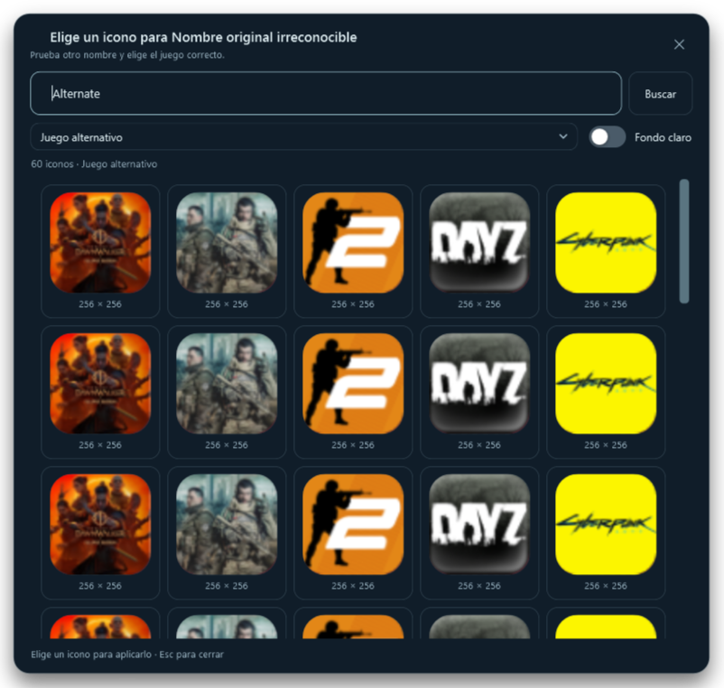
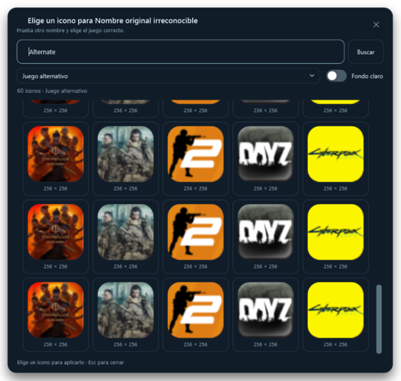

# Buscar y elegir iconos de la comunidad

1. Clic derecho en un icono del dock → **Iconos de la comunidad**.
2. El selector se abre y busca automáticamente. Si el acceso tiene un identificador de Steam, se intenta primero esa coincidencia.
3. Si no aparece el juego correcto, escribe otro título, edición o abreviatura en el buscador. Pulsa **Buscar** o `Enter`.
4. El desplegable permite elegir entre las coincidencias encontradas. Elegir otra carga sus iconos.
5. Pulsa una miniatura para descargar y aplicar el icono completo al acceso original.

La búsqueda alternativa no cambia el nombre del acceso, sus páginas ni sus favoritos. Cerrar sin elegir conserva el icono anterior.

## Presentación y cierre

- Cabecera, buscador, coincidencias, estado y cierre fijos. Solo la galería se desplaza.
- La **X** permanece accesible aunque llegues al final del scroll. También puedes cerrar con `Esc`.
- Miniaturas de 112 unidades, alineadas en tarjetas y ajustadas a la forma de icono del dock, manteniendo la proporción de la imagen.
- **Fondo claro** permite inspeccionar iconos transparentes. Desactívalo para usar el fondo oscuro.
- Cada tarjeta muestra la resolución del icono. Su descripción emergente incluye la puntuación de la comunidad.
- Mensajes dentro de la ventana cuando no hay coincidencias, faltan iconos o falla la conexión. El buscador sigue disponible para reintentar.

El selector necesita la clave personal de SteamGridDB configurada en Ajustes. Las consultas autenticadas se envían a su API; las descargas públicas de las miniaturas no incluyen esa clave.

## Rendimiento y cancelación

Se mantienen hasta cuatro trabajadores de descarga y el límite de 60 resultados. Las miniaturas se decodifican al tamaño de vista previa, considerando la escala de pantalla, y se reutilizan mediante una caché de hasta 64 imágenes congeladas. No se descarga el icono completo para cada vista salvo cuando falta o falla su miniatura.

Buscar de nuevo, elegir otra coincidencia o cerrar cancela el trabajo anterior. Las respuestas retrasadas no sustituyen los resultados actuales. Al elegir un icono se conserva la descarga de su archivo original, sin sustituirlo por la miniatura.

## Validación

191 comprobaciones específicas con un servidor local de prueba: coincidencias múltiples, búsqueda alternativa, `Enter`, desplegable, cierre tras scroll, clave inválida, imágenes dañadas, caché, respuestas tardías, cancelación de consultas y de miniaturas, y selección de la URL original. Español e inglés revisados. No se utilizan claves reales en estas pruebas.

La revisión completa suma **16.160 comprobaciones**. Las capturas siguientes son del selector real con datos de prueba; no representan resultados en vivo de SteamGridDB.

