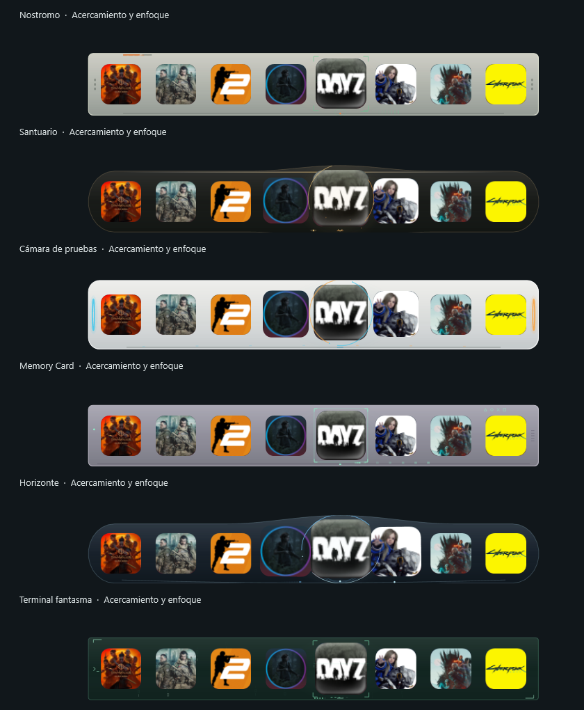

# Temas y personalización · v1.9

Incluye los nueve temas originales y seis materiales nuevos:

- Nostromo / Alien: barrido de detector de movimiento con persistencia de fósforo,
  pulsos de radar y luces de esclusa secuenciadas. El icono responde con un cierre mecánico breve.
- Santuario / Dark Souls: brasas ascendentes, calor en la base y sello incompleto que se aviva.
  Al lanzar, el icono se eleva ligeramente al ritmo de la hoguera.
- Cámara de pruebas / Portal: carga azul/naranja en los dos extremos y transferencia de energía.
  Un portal se abre alrededor del acceso; el icono se comprime, desaparece brevemente y regresa.
- Memory Card / PlayStation: paquetes de memoria por pasos, LED de escritura y cuatro glifos de arranque.
  El acceso responde con una secuencia discreta de lectura.
- Horizonte / Mass Effect: satélite con estela, lente orbital y ondas de campo expansivas.
  Al lanzar, el icono se comprime y se libera con una deformación gravitatoria suave.
- Terminal fantasma / Matrix: columnas de código con cabezas de fósforo y raíl de decodificación.
  Al lanzar, el icono presenta un fallo de señal breve y recupera su imagen.

Cada tema tiene secuencia de presentación al seleccionarlo, movimiento sutil mientras el cursor
está sobre la barra y respuesta propia al lanzar una aplicación. Los efectos de lanzamiento
duran entre 0,95 y 1,7 segundos y se apagan solos. No representan procesos abiertos.
No hay animaciones continuas ni temporizadores adicionales en reposo. Los relojes se liberan
al salir el cursor, ocultar la barra, pasar a Classic o desactivar efectos. Los dibujos son
vectoriales y las transiciones tienen un objetivo de 60 fotogramas por segundo.
Los acabados giran con la barra en sus cuatro posiciones y siguen el contorno al ampliar iconos.
Los temas también se aplican a menús y ajustes; nombres traducidos al inglés.



## Acercamiento adaptado al tema

La opción «Agrandar los iconos al pasar el ratón» utiliza seis perfiles distintos en Animated.
La intensidad, los vecinos afectados, la respuesta del cursor, la elevación del icono y el crecimiento
de la carcasa usan la misma configuración. El enfoque se dibuja en una capa vectorial sobre el icono;
las animaciones de lanzamiento conservan la pose que ya tenía, sin saltar al comenzar.

- Nostromo: aumento contenido (hasta 1,24×), enfoque mecánico con esquinas de detector y carcasa rectangular.
- Santuario: aumento suave (hasta 1,40×), elevación hacia el interior, sello orbital y brasas alrededor del acceso.
- Cámara de pruebas: aumento elástico moderado (hasta 1,36×), apertura azul/naranja alrededor del icono y pieza cerámica estable.
- Memory Card: aumento corto y preciso (hasta 1,22×), selección rectangular y lectura de datos por pasos.
- Horizonte: aumento amplio y progresivo (hasta 1,46×), ligera inclinación, elevación y lente orbital que sigue el enfoque.
- Terminal fantasma: aumento directo (hasta 1,28×), carcasa rectangular, corchetes y escaneo del icono.

Nostromo, Memory Card y Terminal utilizan esquinas de radio pequeño y contorno rectangular exacto,
también durante el acercamiento. Santuario y Horizonte mantienen la respuesta orgánica de su carcasa.
Classic conserva el acercamiento original. Los controles de agrandado y efectos siguen siendo independientes.

## Personalización primero

El bloque principal de Ajustes muestra una barra interactiva. Permite pasar el cursor y pulsar
sus iconos para probar efectos sin abrir aplicaciones. Al cambiar tema, forma, tamaño o interruptores,
se actualizan tanto la muestra como el dock. La muestra conserva el arte de los juegos durante los cambios.

Debajo de la muestra, los temas están a la izquierda y las combinaciones a la derecha:
agrandado, animaciones del tema, forma y tamaño. Debajo hay seis tarjetas abiertas: Barra y contenido,
Comportamiento, Idioma, Iconos de la comunidad, Sistema y Ayuda y proyecto. Los quince temas y todos
los controles se ven al entrar, sin barras de desplazamiento ni grupos plegados. La ventana aprovecha
el ancho disponible y reduce proporcionalmente su contenido si el área de trabajo es menor.
La distribución está traducida al inglés. Verificada visualmente en un área de trabajo de 1536 × 816 unidades WPF.

La muestra conserva sus cinco controles y reutiliza imágenes, estilos y geometría cuando es posible.
El movimiento agrupa los cambios del cursor en una actualización por fotograma, con objetivo de 60 Hz,
y detiene su reloj local al estabilizarse o cerrarse. Las animaciones propias de los temas se conservan.
En una prueba de 200 actualizaciones de configuración, la memoria temporal por actualización pasó de
69.920 a 1.966 bytes (97,2 % menos). Esto no equivale a reducir la RAM total ni la CPU en ese porcentaje.
[rendimiento de la muestra](development/RENDIMIENTO-MUESTRA.md) incluye resultados y límites de la medición.

La etiqueta junto a «Animaciones de los temas» avisa del uso de CPU y memoria. Se puede pulsar para
ver la referencia local y sus límites; el acceso a Ajustes también muestra una indicación de consumo.
No hay un monitor continuo añadido. Las animaciones no son gratuitas: la prueba simplificada con
cursor en movimiento registró aproximadamente 2–3,4 % de CPU total en un equipo de 12 procesadores
lógicos. Con el cursor quieto, las instantáneas de efectos activos mostraron unos 1–4 MB más de memoria
privada y hasta 1,2 MB más de memoria física frente al acercamiento sin efectos. No se midieron GPU,
VRAM, batería ni FPS de juegos. [rendimiento del dock](development/RENDIMIENTO.md) explica condiciones y resultados completos.

Se reutiliza el espacio de trabajo del contorno y se sustituyen claves de texto temporales por
comparaciones numéricas. Se mantienen idénticos los dibujos, los tiempos y el objetivo de 60 Hz.
Las limpiezas manuales de memoria se posponen mientras hay interacción, arrastre, animaciones o Ajustes
abiertos. Reducir asignaciones temporales no equivale a reducir en el mismo porcentaje la RAM total.

El control de opacidad se ha eliminado. La opacidad de la ventana es 100 % en reposo y con el cursor
encima, también al cargar una configuración anterior. Se conserva la transparencia propia del material.
Las instalaciones nuevas usan la forma iOS. Las formas elegidas explícitamente en instalaciones
existentes se conservan; «Cuadrado» corresponde al antiguo valor de configuración «defecto».

En inglés los grupos se llaman Classic y Animated. Clásicos contiene los nueve temas
originales y Animados los seis nuevos. Ambos grupos están visibles al abrir Ajustes.
El ajuste de movimiento se llama Theme animations en inglés. Es independiente de las
animaciones de controles de Windows. Por defecto está activado; desactivarlo conserva el material,
los iconos y el comportamiento habitual. Las miniaturas de Ajustes permanecen estáticas.
La descripción emergente de cada tema explica su referencia y también se traduce al inglés.

## Validación

Compilación sin avisos. Pruebas: 14121 comprobaciones, 540 combinaciones de geometría/material,
60 cambios de tema/posición sobre el dock real, comparación de los nueve contornos originales
y comprobación de grupos y selección en menús y ajustes en español e inglés.
La validación de movimiento comprueba fotogramas diferentes por saga, ambas orientaciones,
tres tamaños de icono, recuperación de tamaño y opacidad, parada de relojes y aislamiento de Classic.
La regresión de agrandado añade 7886 comprobaciones sobre los 15 temas, cuatro posiciones y tres
tamaños: con la opción desactivada la barra no se ensancha ni recorta las esquinas al entrar
el cursor. Desactivarla durante un agrandado restablece inmediatamente iconos y contorno.
Las animaciones propias de cada saga siguen controlándose con su interruptor independiente.
La validación de enfoque coordinado añade 1615 comprobaciones: seis perfiles diferentes, campos
de influencia continuos, cuatro posiciones y tres tamaños, esquinas dentro de la ventana,
composición de enfoque/lanzamiento y restauración al desactivar el agrandado.
La validación de Ajustes añade 330 comprobaciones en español e inglés: jerarquía visual,
controles junto a los temas, muestra interactiva sin lanzamientos reales, actualización de combinaciones,
ausencia del control de opacidad, valores iniciales y heredados, todos los controles visibles sin scroll,
reutilización de los cinco botones, estabilización y parada de la muestra y aviso de consumo.
La regresión de rendimiento añade 27 comprobaciones de inmutabilidad de fotogramas retenidos,
aislamiento por hilo, presupuesto de asignaciones y aplazamiento de limpiezas durante la interacción.
Se compararon además 180 escenas antes/después: todos sus píxeles coinciden.
Las capturas de docs/screenshots/v1.9 se generan con el renderizador WPF de esta edición.

Para repetir pruebas, guarda un ejecutable original como referencia antes de compilar:

```powershell
./app/tests/validate.ps1 -Executable 'C:/ruta/nuevo/GamesDock.exe' `
  -Baseline 'C:/ruta/original/GamesDock.exe' -OutputDirectory 'C:/ruta/pruebas'
```

Basado en https://github.com/sadri-99/GAMESDOCK. Licencia MIT original conservada.
