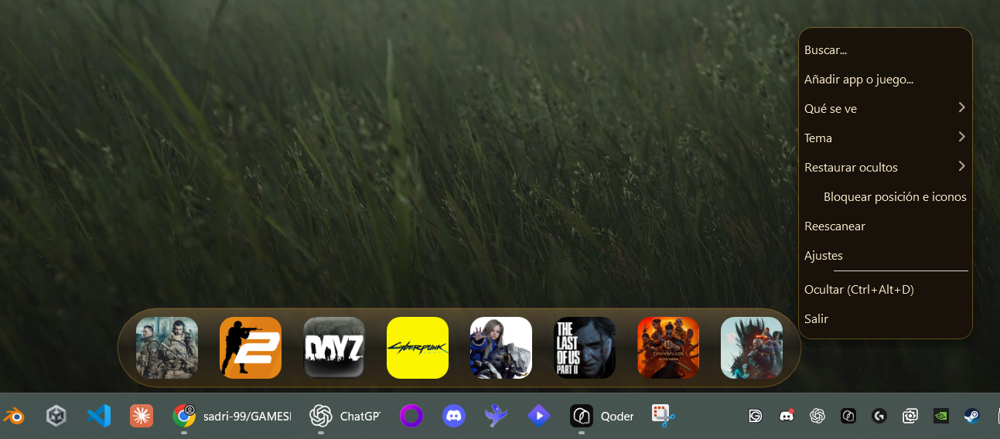
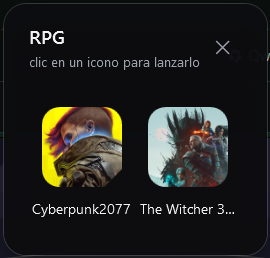
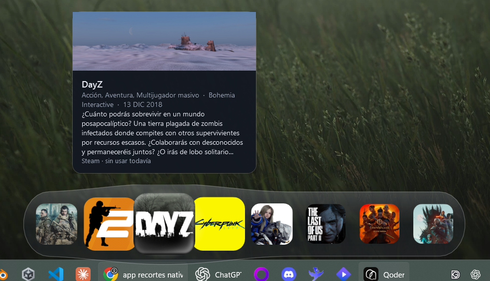
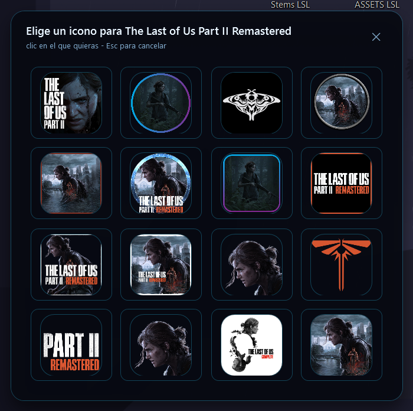

# Guía de uso

[Volver al inicio](../README.md)

## Cómo se maneja

| Gesto | Resultado |
| --- | --- |
| `Ctrl` + `Alt` + `D` | Mostrar / ocultar la barra |
| Doble clic en el icono de la bandeja | Mostrar / ocultar la barra |
| Clic derecho en el hueco libre de la píldora | Menú: Buscar…, Añadir app o juego…, Qué se ve, Tema, Restaurar ocultos, Bloquear posición e iconos, Reescanear, Ajustes, Ocultar, Salir |
| Clic derecho sobre un icono | Favorito, Lanzar ahora, Abrir carpeta del juego, Renombrar, Cambiar icono…, Iconos de la comunidad, Quitar/Ocultar del dock |
| Clic derecho sobre una carpeta | Abrir el grupo, Renombrar, Desagrupar, Ocultar del dock |
| Clic fuera del menú desplegado | Cierra el menú sin activar lo que haya debajo |
| Clic central sobre un icono | Marcar o desmarcar como favorito |
| Dejar el cursor sobre un icono | Sale la **ficha del juego** por encima de la píldora —banner, géneros, autor, fecha y sinopsis—, y se apaga al sacar el cursor. Con la ficha apagada en Ajustes vuelve el globo de texto de siempre |
| Arrastrar la píldora por su cristal —el trozo que no tiene iconos— | Al soltarla se ancla al borde más cercano: abajo, arriba, izquierda o derecha. En posición «Libre» no hay imán y se queda donde la sueltes |
| Arrastrar un archivo hasta la píldora | Fijarlo en la barra |
| Arrastrar un icono dentro de la barra | Reordenar la fila |
| Soltar un icono encima de otro | Crece una carpeta con los dos dentro |
| «Bloquear posición e iconos» en el menú de la píldora | Congela los cuatro gestos de arrastre de arriba —mover la barra, reordenar un icono, fijar un archivo y crear una carpeta— sin tocar los clics: pinchar sigue lanzando |
| Clic en la carpeta | Se abre el contenedor con los iconos de dentro y sus nombres |
| Clic o `Esc` fuera del contenedor | Lo cierra, sin lanzar nada |
| Clic en un icono del contenedor | Lo lanza y cierra el contenedor |
| Clic en una miniatura del selector | Baja ese icono, lo pone en el tile y cierra el selector |
| `Esc` o la cruz en el selector | Lo cierra sin cambiar el icono que había |
| `Enter`, `Esc`, la cruz o «Vale» en un aviso | Lo cierra; la barra de detrás sigue animando mientras está abierto |
| «Abrir ajustes» en el aviso de sin clave | Cierra el aviso y abre Ajustes en la sección de Iconos de la comunidad |
| `Enter` en el panel de actualización | Baja la versión nueva, cambia el programa y relanza la barra |
| `Esc` en ese panel | Lo cierra sin más: la misma versión volverá a ofrecerse al siguiente arranque |
| «Ahora no» en ese panel | Lo cierra y apunta esa versión para no volver a sacarla al arrancar |
| «Buscar actualizaciones» en Ajustes | Comprueba las releases en el momento, aunque la versión estuviera apuntada como rechazada |
| «Estrella en GitHub» en Ajustes | Abre la página del repositorio en el navegador —es lo que hay si la barra te sirve y quieres que se sepa— |
| Soltar un icono fuera del cristal | Ocultarlo; vuelve desde «Restaurar ocultos» |

No hay cuadro de búsqueda, filtros ni engranajes a la vista: la barra es una píldora limpia y todas
esas opciones entran por el menú del clic derecho o por la ventana de Ajustes.

Al arrastrar la píldora por su cristal, el punto donde se ancla al soltarla es **el mismo rectángulo
que pone la chip de posición en Ajustes** —abajo, arriba, izquierda o derecha—, elegido por el borde
al que le queda menos desde donde la sueltas; en una esquina manda el hueco más corto, así que la barra
no se va de lado cuando la dejas a medio camino. Con la posición en «Libre» el imán no entra y la píldora
se queda píxel a píxel donde la soltaste. Lo uno y lo otro se recuperan igual al arrancar.

El **candado** es la fila marcable del menú de la píldora, «Bloquear posición e iconos», y se guarda en
`config.json` como `locked`, así que sigue puesto al arrancar. Puesto, los cuatro gestos que reordenan el
mundo del dock se cortan antes de empezar: la barra no despega de su sitio, ningún icono sale de su hueco,
lo que se suelte encima no se fija y un icono encima de otro no cuaja en carpeta. Lo que sigue vivo es todo
lo que se pide a propósito: lanzar de un clic, el menú de cada icono, ocultar o renombrar, y la chip de
posición de Ajustes —si tú la pulsas, la barra se mueve; quien no puede moverla es el ratón que pasa por
delante—. La palanca del menú se marca con la palomita de siempre, igual que los temas, y el estado se lee
en el log cada vez que se cambia.

El desplegable se cierra con un clic en cualquier punto de la pantalla que no sea el propio menú —el
escritorio, otro icono, otra ventana—, igual que cualquier menú de Windows. Y ese clic no llega a la
ventana que hay debajo: se retira para que no dispare nada por accidente.

Mientras hay una ventana de por medio —Ajustes, el cuadro de renombrar, un aviso— la pantalla se cubre
con un velo tenue (negro al 22 %) que se come todos los clics de fuera: imposible pinchar un icono o
otra ventana mientras el programa espera una respuesta. El velo no roba el foco —el cuadro de texto
sigue escribiendo— y se quita solo cuando se cierra el emergente, sea con Guardar, Enter, `Esc` o la
cruz. El contenedor de una carpeta no es modal: se cierra pinchando fuera o con `Esc`.

## Iconos de la comunidad (SteamGridDB)

[SteamGridDB](https://www.steamgriddb.com) es una biblioteca pública de arte de videojuegos hecha por la
comunidad: para un mismo juego hay decenas de versiones subidas por la gente —logos sueltos sobre fondo
transparente, recortes, arte con estilo propio—, cada una con la puntuación que le da quien la usa. GamesDock
enseña esa lista dentro de la barra y pinta la que tú elijas en el hueco del juego, sin salir de la píldora y
sin pasar por un cuadro de guardado.

Es la única función del programa que pide una credencial. Lo que abre la red son esto y la
[comprobación de actualizaciones](#actualizaciones), que no manda ningún dato tuyo.

### Los tres pasos

1. **Saca tu clave.** Con una cuenta gratis en steamgriddb.com: **Perfil → Preferencias → API → Generate API
   key**. La página exacta es <https://www.steamgriddb.com/profile/preferences/api>, y el botón «Abrir la
   página de la clave» de los ajustes te lleva ahí directamente.
2. **Pégala en Ajustes.** Clic derecho en el hueco libre de la píldora → **Ajustes** → sección
   *Iconos de la comunidad* (el segundo bloque de la columna derecha, para que no haya que desplazar nada):
   el campo «Clave de SteamGridDB», y **Guardar la clave** —o `Enter` dentro del campo, que hace lo
   mismo—. El botón cambia a «Clave guardada» y el valor se escribe en `steamGridKey` de tu
   `%APPDATA%\GamesDock\config.json`. Si prefieres no escribir nada, la variable de entorno
   `STEAMGRIDDB_KEY` gana y el campo sobra.
3. **Pide el icono.** Clic derecho sobre un tile → **Iconos de la comunidad**. Sale una rejilla con las
   miniaturas ordenadas por puntuación de la comunidad; un clic en cualquiera la baja, la reescribe a PNG,
   la guarda en `%APPDATA%\GamesDock\icons\custom\` y repinta el tile. `Esc` o la cruz cierran el selector sin
   tocar el icono que había, y «Quitar icono personalizado» revierte al original.

Mientras se descarga, la barra sigue respondiendo: las peticiones van en `async` y el magnificado no se para.
La lista puede tardar —SteamGridDB no siempre contesta en menos de veinte segundos, y la barra aguanta
hasta cuarenta y cinco antes de dar la petición por perdida—; el subtítulo del selector lo advierte y las
miniaturas van apareciendo solas, cuatro a la vez, sin bloquear nada.

### Por qué hace falta una clave propia

Porque SteamGridDB no contesta a nadie sin credencial. El API v2 exige `Authorization: Bearer <clave>` en
**todas** sus rutas —la búsqueda por nombre, la lista de iconos y la descarga—; sin cabecera la respuesta es
`401` con `{"success":false,"errors":["Authentication Required"]}`, y no hay forma de que la app la salte
por su cuenta. No hay un camino anónimo: las rutas `…/api/public/…` que se citan por ahí responden `404` con
la web delante, y el viejo `api.steamgriddb.com` ni siquiera resuelve. Lo único público de verdad es el CDN de
la propia Valve, que sirve la carátula oficial del juego —justo lo que la barra ya saca de `librarycache` sin
pedir nada—. El arte de la comunidad, que es lo que aporta esta función, solo sale autenticado.

Y la clave tiene que ser tuya, no del programa:

- **Un `.exe` público no guarda secretos.** GamesDock se distribuye como un único binario managed compilado
  con `csc`: cualquiera que lo descargue puede leer las constantes de su IL con un decompiler en un paso, sin
  depurador. Una clave embebida dejaría de ser una clave en cuanto alguien subiera el exe a cualquier sitio.
- **Y quedaría para siempre en el historial de git.** Borrarla en un commit posterior no la borra: vive en
  cada objeto del histórico de un repositorio público.
- **El gasto lo paga quien la registró.** Las claves están atadas a una cuenta y su uso se contabiliza ahí.
  Una clave compartida entre todos los usuarios de la barra se agota o se revoca, y entonces el botón deja de
  funcionar para todo el mundo a la vez, sin que nadie pueda hacer nada.
- **Cifrarla dentro del binario no la protege.** Para usarla el programa tiene que descifrarla, así que el
  secreto que la abre tiene que estar en el mismo binario. Eso es ofuscación: sube el listón de «leer una
  cadena» a «un paso más», y nada más. DPAPI (`ProtectedData`) solo cifra *en reposo* para el usuario de
  Windows que descifra; en tiempo de ejecución el proceso sigue teniendo la clave en claro, así que no
  resolvería lo anterior —y aquí la clave ya es por usuario, con lo que el campo del config es suficiente—.

¿Y qué se gana con registrarse y pegar cuatro caracteres? La cara de cada juego elegida entre las versiones
de la comunidad en vez de conformarse con la carátula oficial, y el control de lo que sale de la máquina: el
app id o el nombre del tile, hacia un solo host, solo cuando tú pulsas el botón.

**Sin clave no pasa nada más.** El botón muestra un aviso de cristal —no un `MessageBox`— que dice dónde
sacarla y dónde se pega, con un botón «Abrir ajustes» que deja el panel delante con la sección a la vista. El
resto de la barra no se entera: fuera de esta función y de la comprobación de versiones no hay ninguna ruta
del programa que toque la red.

## La ficha del juego

Dejar el cursor sobre un icono enseña una **ficha** por encima de la píldora —no un globo de texto—: un
banner del juego y, debajo, el título, los géneros · el desarrollador · la fecha de lanzamiento, la sinopsis
corta de la tienda y un pie que dice de dónde salió el acceso y cuántas veces lo has lanzado. Se apaga sola
al sacar el cursor, se puede pasar el ratón por encima sin tocarla —es *click-through* y nunca pide el
foco—, y sale siempre **hacia el lado de dentro** de la barra: encima del icono cuando la píldora está
abajo, debajo si está arriba, y a un lado si la barra vive en un canto.

### Qué se ve y cuándo

- Entra a los **380 ms** de tener el cursor quieto sobre el icono: lo que tarda el globo de siempre
  (500 ms) sin dar tiempo a que salte sola con solo barrer la fila. Si ya había una ficha abierta y pasas
  a otro icono, la espera baja a **140 ms** —ya estás mirando, no hay que volver a ganarse la
  atención—.
- El banner se elige **al azar entre los que ya están bajados** para ese juego, así que dos pasadas
  seguidas por el mismo icono suelen enseñar dibujos distintos. Son los *heroes* de SteamGridDB —los
  banners horizontales que sube la comunidad—, el mismo arte del selector de iconos pero en su versión
  ancha.
- El cuadro del banner **mide lo que mide el dibujo**, no lo que mida la carta. Los *heroes* de la comunidad
  salen a 850×274 (3,10:1) y la cápsula de la tienda a 460×215 (2,14:1): con un alto fijo de 140 DIP,
  `UniformToFill` llenaba la altura y se comía un tercio del ancho de los *heroes* —70 px por cada canto—,
  que es justo lo que hacía parecer que el arte «salía cortado» en *Counter-Strike 2* o *PRAGMATA*. Ahora el
  alto sale de la proporción del mapa de bits (95 DIP para un *hero*, 137 para una cápsula), sujeto entre 84
  y 176: un 21:9 no puede quedarse en una tira de 40 px y un dibujo cuadrado no puede ocupar media carta.
  Fuera de esas dos franjas se recorta por igual arriba y abajo, que es donde un *hero* pierde menos cosas
  que en los cantos.
- Si la tienda no conoce el juego la ficha no sale en blanco: sale con el nombre, la ruta de instalación y
  el pie, que es justo lo que decía el globo viejo.
- Las **carpetas** no sacan ficha nunca: su hueco es un mosaico y el contenedor ya enseña los nombres.

### De dónde sale cada dato

| Parte | Origen |
| --- | --- |
| Título, sinopsis, géneros, desarrollador y fecha | `GET https://store.steampowered.com/api/appdetails?appids=<id>&l=<idioma>` —la API pública de la tienda, sin cuenta ni clave— |
| El app id cuando la barra no lo trae | `GET .../api/storesearch/?term=<nombre del tile>`: se queda con el primer resultado. Se busca con el nombre tal y como lo enseña la barra y **sin** `l`, porque con `l=es` «Counter-Strike 2» sale como «Contragolpe 2» y ahí ya no hay app id que valga |
| Banner | `/heroes/steam/<appid>` o `/heroes/game/<id>` de SteamGridDB para **listarlos**, y la imagen del CDN público `cdn2.steamgriddb.com` para **bajarla** |
| Banner sin clave | `header_image` de la propia tienda —la cápsula ancha de la página del juego—, que también es un banner y no pide ninguna credencial |
| El pie («Steam · sin usar todavía», «Añadido a mano · 3 veces») | Lo que la barra ya sabe de sí misma: el origen del acceso y su contador de lanzamientos |

Los textos salen **en el idioma de la interfaz**: la ficha pide `l=spanish` o `l=english` según lo que
tengas puesto en Ajustes. No vale el código de dos letras —`l=es` la tienda lo ignora y devuelve la
descripción en inglés—, y la fecha llega ya escrita como la escribe Steam («13 DIC 2018»), así que no se
formatea.

### Una vez por juego, y ya no se vuelve a pedir

Todo se guarda en `%APPDATA%\GamesDock\cards\`: la ficha en `steam-<appid>.json` —o `n-<hash>` cuando el
acceso no sale de Steam, para que dos tiles que apuntan al mismo juego compartan ficha y banners—, y cada
banner en `b-<hash de la url>.img`. A partir de ahí la ficha sale **sin red**. La primera pasada de un
juego nuevo dispara la petición y puede enseñar solo los textos —el banner entra en la siguiente pasada,
que es cuando ya está en disco—; las siguientes salen completas al instante. Se guarda también el «lo busqué
y no había nada», que es lo que evita que el cursor toque la red en cada pasada de una app que la tienda no
conoce. Los banners se podan a los 60 más recientes para que la función no se coma la caché de los iconos.

### Apagarla

Ajustes → *Comportamiento* → **«Ficha del juego al pasar el ratón (banner y descripción)»**. Al apagarla
vuelve el globo de tres líneas de siempre —nombre, de dónde salió y ruta de instalación— y la barra deja de
pedir fichas: con la palanca abajo no hay ninguna salida a internet por ese lado. La palanca se nota al
momento, sin reiniciar.

## Apoyar el proyecto

En Ajustes → Ayuda y proyecto, «invítame a un café» está junto a «Estrella en GitHub». Abre [PayPal](https://www.paypal.com/paypalme/sadriprods) en el navegador. En inglés se llama «Buy me a coffee».

## Dónde guarda sus cosas

Se queda íntegramente en el perfil de usuario. El registro solo se lee, nunca se escribe.

| Ruta | Contenido |
| --- | --- |
| `%APPDATA%\GamesDock\config.json` | Ajustes —incluido el idioma, la palanca de la ficha de hover, la clave de SteamGridDB y la versión de actualización que has rechazado—, fijados, orden, favoritos, usos, grupos y mapa de accesos movidos |
| `%APPDATA%\GamesDock\dock.log` | Bitácora de arranque, detección, actualizaciones y errores; se vacía al superar 256 KiB. Nunca guarda la clave: dice si se guardó, no cuál es |
| `%APPDATA%\GamesDock\icons\` | Caché de iconos en PNG de 256 px |
| `%APPDATA%\GamesDock\icons\custom\` | Copia del icono propio de cada fijado, con nombre-hash; aquí cae también el PNG que baja «Iconos de la comunidad». Si borras el original, el tile no se queda vacío |
| `%APPDATA%\GamesDock\cards\` | La ficha de hover: `steam-<appid>.json` (o `n-<hash>` para lo que no sale de Steam) con los datos del juego, y `b-<hash>.img` con cada banner bajado. Se poda a los 60 banners más recientes. Borrar la carpeta solo cuesta volver a pedir los juegos que se vuelvan a pasar por encima |
| `%APPDATA%\GamesDock\escritorio\` | Copias de los accesos movidos desde el escritorio |
| `%APPDATA%\GamesDock\update\` | Solo durante una actualización: el ejecutable bajado mientras espera a poder sustituir el viejo. Se borra entera al terminar, así que en una barra sin actualizar ni siquiera existe |
| `%LOCALAPPDATA%\Programs\GamesDock` | Ejecutable y desinstalador cuando se usa el asistente |
| Tarea `GamesDock-<SID del usuario>` | Inicio directo al entrar en Windows, sin VBS; ver [inicio con Windows](INICIO-WINDOWS.md) |

Borrar `%APPDATA%\GamesDock` deja la aplicación como recién instalada; lo único que puede quedar es
el acceso de `%STARTUP%` si activaste el arranque con Windows. El único sitio fuera de esa carpeta que
toca la barra es `%TEMP%`, y solo durante una actualización: el `.cmd` que hace el cambio, que se borra a
sí mismo en cuanto lo hace.
