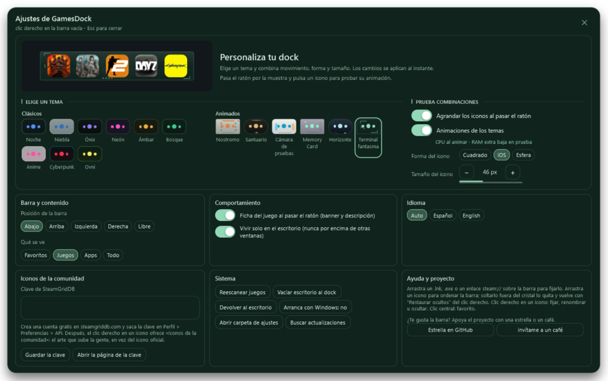
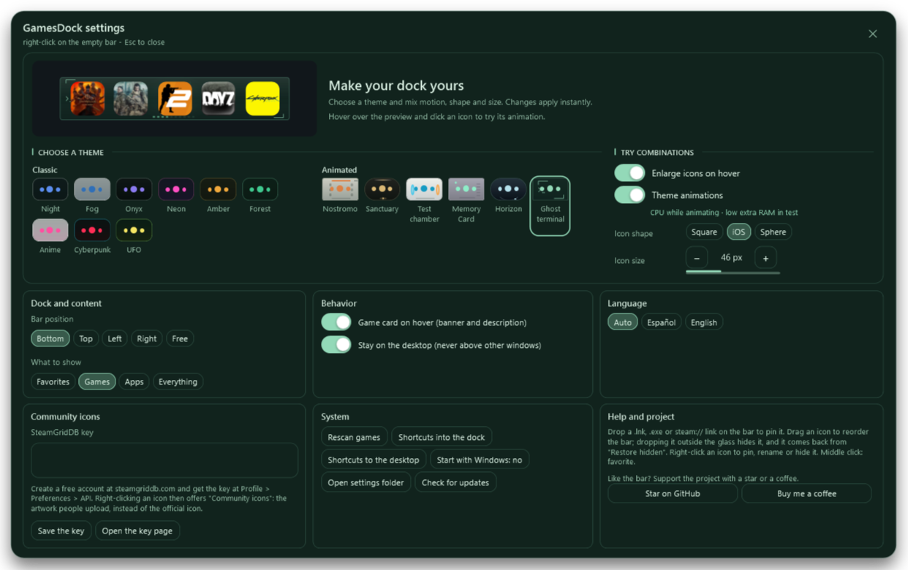

# GamesDock v1.9.1

## Apoya el proyecto

Nuevo botón **«invítame a un café»** junto a **«Estrella en GitHub»** en Ajustes → Ayuda y proyecto.

Abre [PayPal](https://www.paypal.com/paypalme/sadriprods) en el navegador. En inglés aparece como **Buy me a coffee**. Ambos botones permanecen en la misma fila y todos los ajustes siguen visibles sin scroll.

El repositorio incluye ahora un apartado de donaciones en español e inglés y el mismo enlace en su configuración de patrocinio.

## Descargar y actualizar

Descarga **GamesDock.exe** o **GamesDock-v1.9.1-win-x64.zip**. Windows 10/11 x64 y .NET Framework 4.8. Cierra la instancia anterior desde la bandeja antes de sustituir el ejecutable manualmente. Se conserva la configuración de `%APPDATA%\GamesDock`.

El ZIP contiene ejecutable, licencia y notas. **SHA256SUMS.txt** permite comprobar las descargas. Código fuente disponible en el tag v1.9.1 y en los archivos Source code de GitHub.

## Validación

Compilación correcta y **332 comprobaciones de Ajustes** superadas. Revisadas las capturas en español e inglés. Metadatos de producto actualizados a 1.9.1.

[Historial de cambios](https://github.com/sadri-99/GAMESDOCK/blob/v1.9.1/CHANGELOG.md)

## English

A **Buy me a coffee** button now sits beside **Star on GitHub** in Settings → Help and project. It opens the same [PayPal donation page](https://www.paypal.com/paypalme/sadriprods) used by the repository's new donation sections and funding link.

Both buttons stay on the same row. All settings remain visible without scrolling. Spanish and English screenshots reviewed; 332 settings checks passed. Download the executable or portable ZIP and exit the previous tray instance before manual replacement. Existing preferences are preserved.
