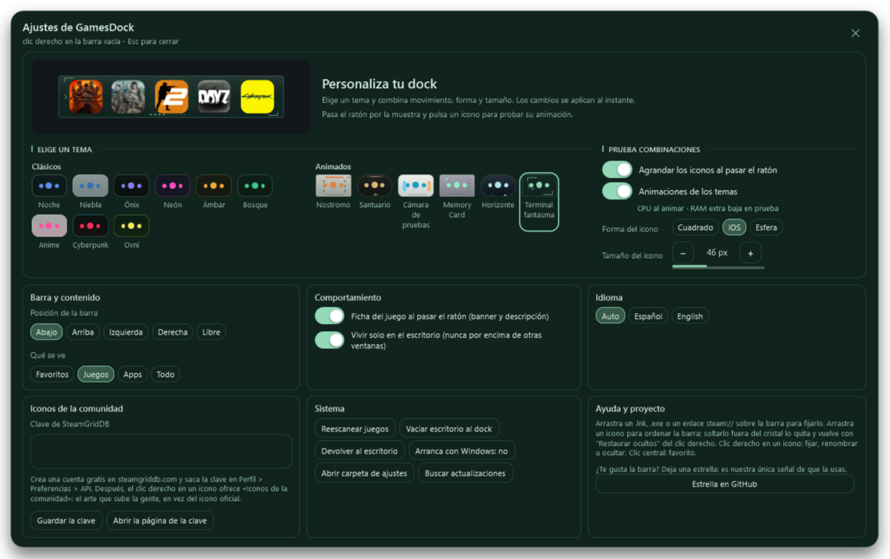
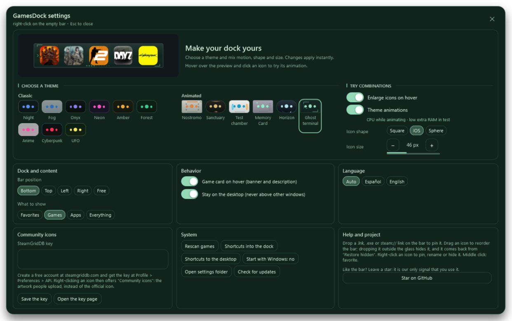
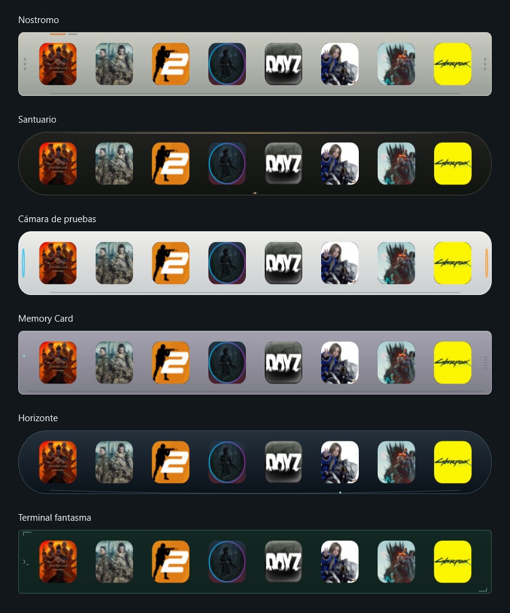

# GamesDock v1.9

Quince temas, seis materiales animados y ajustes completos sin scroll.

## Novedades

- **Clásicos / Classic:** nueve temas originales.
- **Animados / Animated:** Nostromo, Santuario, Cámara de pruebas, Memory Card, Horizonte y Terminal fantasma.
- Radar, brasas, portales, memoria, campos orbitales y código con movimiento propio de presentación, enfoque y lanzamiento.
- Agrandado adaptado al material y contorno, incluidos temas rectangulares.
- Muestra interactiva, miniaturas alineadas y todos los ajustes visibles al entrar. Español e inglés.
- Opacidad al 100 %; forma iOS para instalaciones nuevas, conservando elecciones anteriores.
- Corregidas las esquinas al entrar con el agrandado desactivado.

## Rendimiento

La muestra reutiliza cinco controles y agrupa cambios por fotograma. En la prueba local, asignaciones temporales por actualización de configuración bajan un **97,2 %**. Se mantienen efectos y objetivo de 60 Hz.

No equivale a reducir RAM total ni garantiza menor CPU: la respuesta más frecuente aumenta CPU en algunos temas. Ajustes incluye información del coste. GPU, batería y FPS de juegos no se midieron.

## Capturas

## Instalar o actualizar

Windows 10/11 x64 con .NET Framework 4.8. Descarga **GamesDock.exe**, guárdalo en una carpeta permanente y ejecútalo. También se ofrece **GamesDock-v1.9-win-x64.zip** con ejecutable, licencia y notas.

Cierra la copia anterior desde la bandeja antes de reemplazarla manualmente. Configuración y juegos se conservan en `%APPDATA%\GamesDock`. Sin instalador; ejecutable sin firma digital.

Consulta **SHA256SUMS.txt** para verificar descargas. El código está en los archivos Source code de GitHub y en el tag v1.9.

## Validación y documentación

14.121 comprobaciones superadas, ajustes revisados en ambos idiomas y 180 escenas con píxeles idénticos tras optimizar el renderizador.

[Todos los cambios](https://github.com/sadri-99/GAMESDOCK/blob/v1.9/CHANGELOG.md) · [Guía de uso](https://github.com/sadri-99/GAMESDOCK/blob/v1.9/docs/USO.md) · [Mediciones](https://github.com/sadri-99/GAMESDOCK/blob/v1.9/docs/development/RENDIMIENTO-MUESTRA.md)

## English

Six saga-inspired animated themes join the nine classics. Theme-specific magnification, an interactive preview and every setting on one screen, in Spanish and English. Fixed corner clipping with magnification disabled; new installations default to iOS shape.

The preview reuses five controls and measured 97.2% fewer temporary allocations per configuration refresh. Effects and the 60 Hz target are preserved; CPU does not decrease in every case. No GPU or game-FPS claim is made.

Download GamesDock.exe or the portable ZIP. Exit the old tray instance before manual replacement. Preferences remain in AppData. Windows x64 and .NET Framework 4.8 required; unsigned executable. Source, documentation, screenshots and checksums accompany this release.
