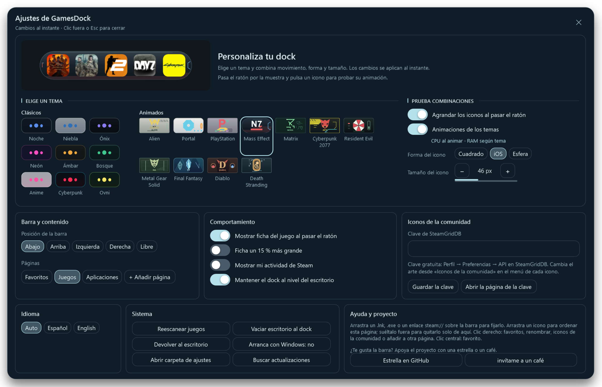
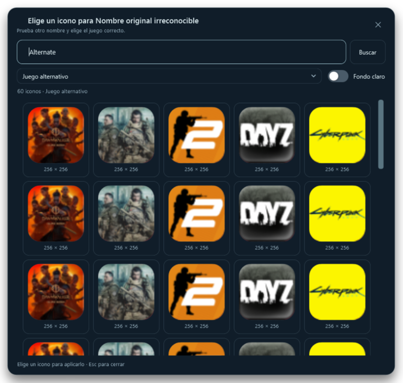

# GamesDock v2.00

Juegos, aplicaciones y páginas propias en un dock para Windows 10/11 x64. Esta versión reúne todos los cambios posteriores a la última actualización del repositorio, basada en v1.9.5.

## Temas y personalización

**20 temas: nueve clásicos y 11 animados**. Alien, Portal, PlayStation, Mass Effect, Matrix, Cyberpunk 2077, Resident Evil, Metal Gear Solid, Final Fantasy, Diablo y Death Stranding tienen superficies y secuencias propias, con aumento de iconos adaptado a cada contorno.

- Márgenes originales compactos; sin sellos ni logos bajo el icono activo.
- PlayStation sin símbolos redundantes. Cyberpunk al doble de duración, manteniendo la fluidez del movimiento.
- Diablo sin círculo de seguimiento ni runas estáticas centrales. Death Stranding sin instrumentos fijos de extremos y con más gotas que resbalan.
- Retirados Dark Souls, Dragon Ball, Hollow Knight, Unturned, Kingdom Hearts, GTA VI y Pokémon. La selección anterior de uno de ellos pasa a Noche.

### Ajustes con Horizonte

Personalización prioritaria, temas y controles juntos. Resto de ajustes visible sin pestañas ni scroll general; solo se desplazan las miniaturas de temas. Clic fuera, Esc y cruz guardan y cierran.

## Páginas y varias pantallas

- Favoritos, Juegos y Aplicaciones, más hasta cinco páginas personalizadas. Contenido, orden y carpetas independientes; añadir un acceso no lo convierte en favorito.
- Crear, renombrar y eliminar páginas, o añadir un acceso existente a otra. Favoritos es fija y editable manualmente.
- Menús simplificados y con márgenes uniformes; bloqueo resaltado sin tick ni hueco reservado.
- Arrastrar a otro monitor guarda pantalla y posición. Colocación adaptada a su área útil y escala; recuperación visible al desconectarlo.

## SteamGridDB y fichas

Elige **iconos de la comunidad desde el propio dock**. El selector permite buscar nombres alternativos, escoger juego o edición y explorar tarjetas mayores. Búsqueda, estado y cierre permanecen visibles al hacer scroll. Incluye cancelación, reintentos y caché acotada. Necesita una clave personal gratuita de SteamGridDB.

Las fichas tienen banner redondeado y texto más espaciado. Opciones independientes de tamaño al 115 % y actividad Steam: horas, última partida y período reciente cuando está disponible. La actividad es local, usa la cuenta activa y viene desactivada.

## Rendimiento y compatibilidad

Muestra reutilizable, caché de columnas Matrix y relojes detenidos al terminar; sin recortar los efectos. Ajustes incluye explicación del coste. La referencia local de los 11 temas oscila aproximadamente entre 2,6 y 5,3 % de CPU total, con ocho accesos y 12 procesadores lógicos, en una ventana fuera de pantalla. No es una medición de GPU ni FPS de juegos.

**23.065 comprobaciones locales superadas**, además de regresiones de inicio, selección de actualización y versión. [Evidencia y límites](https://github.com/sadri-99/GAMESDOCK/blob/v2.00/docs/development/VALIDACION-v2.00.md). [Changelog completo](https://github.com/sadri-99/GAMESDOCK/blob/v2.00/CHANGELOG.md).

## Descargar y actualizar

- **GamesDock-Setup-2.00.exe:** asistente español/inglés por usuario, sin administrador.
- **GamesDock.exe:** ejecutable portable y archivo que usa el actualizador integrado.
- **GamesDock-v2.00-win-x64.zip:** portable con guías y licencia.
- **GamesDock-v2.00-Fuentes.zip:** código fuente y documentación del mismo commit.
- **SHA256SUMS.txt:** integridad de los archivos adjuntos.

Requiere Windows 10/11 x64 y .NET Framework 4.8. Cierra la copia anterior desde la bandeja antes de actualizar. Se conservan configuración, accesos y favoritos; la migración de páginas se realiza al abrir. El instalador mantiene su identidad, ruta y preferencia de inicio. No se distribuyen datos personales ni claves. Ejecutables sin firma digital.

## English

GamesDock v2.00 adds independent pages, remembered display placement, alternative-name SteamGridDB search with a fixed close/search header, improved game cards with optional local Steam activity, compact settings and 11 individually animated themes alongside nine Classic themes. Pokémon and the other retired themes fall back to Night. Existing user data is preserved. Windows 10/11 x64 and .NET Framework 4.8 are required. Setup and the app support English and Spanish. Download the setup wizard or portable executable below.
